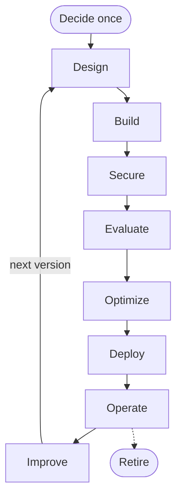

# Chapter 1: What an Agent Is (and Isn't)

Priya writes in. The standing desk she paid express delivery for, order #4471, still hasn't shipped, and she wants the express fee back if it won't arrive by Saturday. You could hand her email to an agent that looks up orders and issues refunds, or to one model call that summarizes it for a fraction of a cent. Which one you need is the first question of agent building, and most teams answer it too quickly. To answer it well, you need to know what a single call to a large language model (LLM) can do on its own, and exactly where it runs out.

**What you'll build:** a one-call summarizer, a fixed workflow and a written design note that decides whether a problem needs an agent at all.

**Prerequisites:** Chapter 0 and the Python interlude, or equivalent experience: you can run a Python file from a terminal and read a dictionary.

## Learning objectives

By the end of this chapter you can:

- Make an LLM API call and read its response, token usage and stop reason.
- Show three kinds of questions a plain LLM cannot answer reliably.
- Decide whether a problem needs an agent or something simpler, and which kind of agent.
- Name the four parts of every agent: model, tools, loop and stop condition.
- Place a system on the dimensions of agency, the reference model and the lifecycle.

**In the real world.** Most "AI features" in products today are one well-prompted LLM call: summarize this ticket, classify this email, draft this reply. Anthropic's guide *Building effective agents* says optimizing a single call with retrieval and examples "is usually enough" for many applications.

## 1.1 Anatomy of an LLM call

An LLM API call sends a list of **messages** and gets one new message back. Each message has a **role** (`user` or `assistant`) and **content**. A **system prompt** sets the model's behavior for the whole conversation.

@@code ch01_summarize.py

Run it and look at three things in the response:

- `response.content`: a list of **content blocks**. Current models such as Claude Sonnet 5 think before they answer, so a `thinking` block usually comes before the `text` block. That's why the listing picks blocks by `type`.
- `response.usage`: input and output **tokens**, chunks of text of roughly ¾ of a word. You pay per token, and the model sees only so many at once (its **context window**). Thinking counts as output, so leave `max_tokens` room.
- `response.stop_reason`: why the model stopped. `end_turn` means it finished, `max_tokens` means it was cut off, and `tool_use` (Chapter 2) means it wants a tool. Chapter 4 handles the rest, such as `refusal`.

:::note What you should see
One sentence, then a line of counts, such as:

```
Priya's express-delivered standing desk (order #4471) hasn't shipped; she wants its location and an express-fee refund if it won't arrive by Saturday.
input tokens=118 output tokens=212 stop_reason=end_turn
```

Your sentence and counts will differ; `stop_reason=end_turn` is what to check. `stop_reason=max_tokens` with little or no text means thinking used up the limit, so raise `max_tokens`. An `AuthenticationError` means the key isn't set (section 0.5).
:::

:::tip The model has no memory between calls
Every call is independent. For the model to "remember" earlier messages, you send them again. That's why agents keep a growing message history, and why their costs grow with it.
:::

## 1.2 Where plain LLMs fail

An LLM is good at language and reasoning, but it has three hard limits:

1. **It doesn't know the present.** Its knowledge stops at a training cutoff, and it has no clock.
2. **It is unreliable at exact computation.** It can estimate 48,213 × 9,771, but it may get digits wrong.
3. **It cannot see your private data.** Your files, databases and company systems were never in its training data.

@@code ch01_where_llms_fail.py

Run it and compare the answers to reality. The model may guess a date, get the product slightly wrong, and either refuse or invent a password. Each failure points to a missing **tool**: a clock, a calculator, a file reader. The rest of the book adds them.

## 1.3 Do you actually need an agent?

An agent is slower than ordinary software, costs more, is harder to test and fails in ways a function can't. So the first design question is always: why introduce autonomy here? If the whole flowchart fits on a napkin, a workflow will be cheaper and easier to test. Line up the options:

Table: Options from least to most autonomous
| Option | Who decides the steps? | Use it when (example) |
| --- | --- | --- |
| Function | You, in code; no model | The rules are exact (a refund from a price and a date) |
| Single LLM call | Nobody; there is one step | One prompt does the job (summarize a document) |
| Workflow | You, with model calls at fixed steps | The steps are known in advance (extract, classify, draft a reply) |
| State machine | You: states and allowed transitions, with model calls inside states | The process has stages and audits (a refund case: received, approved, refunded) |
| RAG (retrieval-augmented generation) | You: search, then one model call over the results | The answer is in documents (the policy handbook) |
| Agent | The model, at run time | The steps depend on what you find ("why did checkout get slow yesterday?") |
| Multi-agent system | Several models, coordinated by code | The work splits into independent parts |

A **workflow** follows a path you wrote: predictable, cheap, easy to test. An **agent** lets the model choose the next step from the results so far. It's flexible, but it costs more, and its mistakes compound.

Before you choose an agent, answer these questions honestly:

1. **Can I draw the flowchart before the task starts?** If yes, a workflow or state machine is cheaper and more reliable.
2. **What does a wrong step cost?** The more an action can hurt money, data or customers, the more of it belongs in code.
3. **Can I tell when it's done and whether it's right?** An agent you can't evaluate is a demo, not a product (Chapter 27).
4. **Is the flexibility worth several times the cost and latency?** Measure it (exercise 1.7).

:::tip Rule of thumb
If the flowchart depends on what you discover, build an agent; otherwise build a workflow. Either way, keep the rules that must never bend in code. Chapter 22 takes that all the way: code controls every decision that must be right every time, and the model keeps the judgment calls.
:::

## 1.4 What makes a system agentic?

"Is it an agent?" turns out to be the wrong question, because systems are more or less agentic. They sit on a spectrum, and each step to the right hands the model more of the decisions:

@@image d-92d2373df655.png

Figure: The spectrum of agentic systems
Alt: Six boxes in order, each handing the model more of the decisions: LLM call, workflow, tool-using agent, autonomous agent, multi-agent system, long-running agent.

What moves a system along it is a set of **dimensions of agency**. Use them to describe a system precisely instead of arguing about whether it "is an agent":

Table: The dimensions of agency
| Dimension | The question it answers | Where this book builds it |
| --- | --- | --- |
| Autonomy | How many decisions does the model make without a person? | Chapters 4, 9, 22 |
| State | What does it keep track of between steps and sessions? | Chapters 5, 17, 19 |
| Planning | Does it decide the steps before acting, and revise them? | Chapter 20 |
| Tool use | Which actions can it take in the world? | Chapters 2, 3, 7, 8 |
| Environmental interaction | Can it explore its surroundings: files, pages, screens? | Chapters 6, 10, 23 |
| Persistence | Does its work survive crashes and run for hours? | Chapter 19 |
| Feedback | Does it check results and correct itself? | Chapters 8, 10, 27 |
| Delegation | Can it hand work to other agents? | Chapters 11, 13, 21 |
| Adaptation | Does it change its behavior from experience: memory, skills? | Chapters 17, 24 |

A summarizer scores low on every dimension. The code-fixing agent of Chapter 10 scores high on tool use, environment and feedback but low on persistence. A multi-day research agent scores high on almost all of them. Each dimension you turn up adds capability, and it also adds a new way to fail, so turn up only what the task needs.

## 1.5 The four parts of an agent

Every agent in this book, from the calculator to the MCP capstone, has the same four parts:

Table: The four parts of an agent
| Part | What it is | Where you'll build it |
| --- | --- | --- |
| Model | The LLM that decides what to do | Every chapter |
| Tools | Functions the model can ask your code to run | Chapter 2 |
| Loop | Code that runs tools and returns results until the model is done | Chapter 4 |
| Stop condition | When to end: a final answer, an iteration cap, a budget | Chapter 4 |

Here is the whole idea in pseudocode:

```
messages = [user_question]
while True:
    response = llm(messages, tools)
    if response wants a tool:
        result = run_the_tool(...)      # YOUR code runs it, not the model
        messages += [response, result]  # the model sees the result next time
    else:
        return response.text            # the model is done
```

Look at the comment on `run_the_tool`. The model never runs anything itself; it only asks, and your code decides whether and how to act. Almost every safety control in this book depends on that separation, so it's worth noticing now, while the loop is six lines long.

@@image d-f180645aa742.png

Figure: The four parts of an agent: model, tools, loop and stop condition
Alt: A user question goes to the model. The model either gives a final answer or asks for a tool; your code runs the tool and sends the result back to the model. A stop condition, such as an iteration cap or a budget, can also end the loop with an answer.

:::tip Where this book is heading: MCP
For most of the book, your tools are Python functions in your own program. In Part 5 you'll package them as **MCP servers**: the Model Context Protocol (MCP) is the open standard that lets any compatible agent use them, from Claude Desktop or Cursor to one you write. The habits you build from Chapter 2 on carry straight over.
:::

## 1.6 A fixed workflow, for contrast

Before you build agents, build one workflow so you can feel the difference. This support-email workflow always runs the same three steps in the same order:

```
def handle_email(email: str) -> str:
    fields = llm(f"Extract order_id and complaint as JSON:\n{email}")
    category = llm(f"Classify as refund, shipping or other:\n{fields}")
    return llm(f"Draft a polite reply for a {category} request:\n{fields}")
```

The model decides nothing here except the text inside each step. If Priya's email needs an order lookup, this workflow can't do it, because nobody wrote that step. An agent could decide to look the order up, and that flexibility is exactly what you pay extra for.

## 1.7 The agent architecture reference model

:::note A map, not a test
Sections 1.7 to 1.10 are a map of the whole book. If you're new, skim them now without memorizing a single table, and come back after Chapter 4, when you've built an agent and the labels mean something.
:::

The four parts make an agent that works on your laptop. A production system needs more layers, whatever its language, model or framework, and the **agent architecture reference model** names them:

@@image d-bf14742724b1.png

Figure: The agent architecture reference model {#f:reference-model}
Alt: Layers from top to bottom inside a frame labeled evaluation and observability across all layers: user or API; the agent runtime, containing planning, memory, context, tools and policies; the model; MCP, APIs and A2A; and the environment.

Table: The layers of the reference model
| Layer | What it does |
| --- | --- |
| User / API | How requests arrive: a chat, an app, another service |
| Agent runtime | The loop and what it manages: steps, limits, retries, sessions |
| Planning | Deciding, checking and revising the steps |
| Memory | What it keeps across sessions, under which rules |
| Context | What goes in front of the model on each call |
| Tools | The actions the agent can take |
| Policies | Rules code enforces: permissions, approvals, budgets, guards |
| Model | The LLM that decides the next step |
| MCP, APIs, A2A | How tools and other agents are reached; A2A is the Agent2Agent protocol |
| Environment | What it acts on: files, databases, browsers, other systems |
| Evaluation and observability | How you know it works, and what it did, at every layer |

Each later chapter opens with a **You are here** line naming the layers it builds, and section 30.15 returns to {{f:reference-model}} once you've built them all. Two ideas run through every layer.

**Context engineering.** During a call, the model knows only what's in its context window: the system prompt, the conversation, the tool definitions and the tool results. Its decisions are only as good as what you put in front of it, and what you leave out. Choosing that, call by call, is *context engineering*, and Chapter 16 takes it on directly.

**The model proposes, code decides.** Everything around the model (the loop, the tools, the checks, the limits) is the *harness*, and it's yours. The model chooses what to try next. The harness decides what's allowed, checks what came back and stops the run when it should. The more an agent can do, the more work moves into the harness, which in the reference model means the runtime and the policies.

## 1.8 The route, and one agent to follow through it

Each part answers one question about your agent, and together they make one route: **build, secure, evaluate, optimize, deploy**.

Table: The route through the book, one question per part
| Question | What you add | Part |
| --- | --- | --- |
| Can it act? | Tools, the loop and stop conditions | 1 |
| Can it keep track and look around? | State that outlives a session; search over files | 2 |
| Can it work with real systems, safely? | APIs, self-correction, human approval | 3 |
| Can it check its own work, or split a big job? | Feedback loops and teams of agents | 4 |
| Can any app use its tools, and it use theirs? | MCP servers and clients | 5 |
| Does it know the right things at each step? | Context engineering, memory and knowledge | 6 |
| Can it run for hours, plan and cooperate, with code in control? | Durable jobs, planning, orchestration, deterministic controls | 7 |
| Can it be turned against you? | Security and agent identity | 8 |
| Is it measured, observed, affordable and deployed? | Evaluation, observability, performance, deployment | 9 |
| Can it work in someone else's business? | Discovery, customer constraints, a signed pilot and a handoff | 10 |

Most chapters build a small agent of their own. You'll also follow one system through the book, **the enterprise support agent** for an online store, the one that will eventually answer Priya properly. Boxes titled *The support agent so far* show what each chapter adds.

Table: How the support agent grows, chapter by chapter
| Chapter | The support agent gains |
| --- | --- |
| 1 | A single call, then a fixed workflow |
| 2, 4 | Tools and the loop: several order lookups in a row, with a step cap and a trace |
| 5 | State: open cases that survive a restart |
| 7 | A real API: carrier tracking with timeouts, retries and a cache |
| 9 | Approval: a person approves every refund |
| 12, 14 | MCP: its order tools packaged for any host; the helpdesk's server behind a policy layer |
| 16–18 | Context, memory and knowledge: the right records, returning customers, cited policy answers |
| 19 | Durability: refunds that wait days for a returned parcel |
| 20, 21 | Routing between small and large models; specialists for billing and shipping |
| 22 | Control: a state machine and rules as data around every refund |
| 25, 26 | Security and identity: emails read by a model that can't act; short-lived tokens |
| 27–29 | Evaluation, observability, performance: a release gate, SLOs, cost per resolved conversation |
| 30 | Production: a secure service on a shared platform |

Capstone 1 asks you to build its core yourself, with a reference solution to compare against.

## 1.9 Kinds of agents and when to use each

Once you need an agent, the next question is which kind. They all run the same loop but differ in what they act on, how long they run and what can go wrong:

Table: Kinds of agents and when to use each
| Kind | Choose it when | Main risk to control | Built in |
| --- | --- | --- | --- |
| **Assistant with tools** | Questions need live or private data | Wrong tool or invented answer | Chapters 2–5, 7 |
| **Knowledge agent**: answers from documents, with citations | The answer is written down, but where varies | Answers the sources don't support | Chapters 6, 18 |
| **Data analyst**: turns questions into queries | People ask new questions of one database | Plausible numbers from a wrong query | Chapter 8 |
| **Action agent behind approvals**: changes records or money | The change depends on judging a messy request | Damage from one wrong action | Chapters 9, 22, 26 |
| **Feedback-loop agent**: works until a check passes | Tests, a validator or a compiler can check the work | Gaming or editing the check itself | Chapter 10 |
| **Research team**: a lead and parallel subagents | A broad question splits into independent parts | Cost multiplied by the number of agents | Chapters 11, 21 |
| **Planner**: writes the steps first, then runs them | Long tasks where "done" must be defined up front | A bad plan run faithfully | Chapter 20 |
| **Long-running agent** | The job outlives one process or one sitting | Repeated side effects after a restart | Chapter 19 |
| **Computer-use agent**: operates a screen | The only way in is a user interface | One click that can't be taken back | Chapter 23 |

Every row also has a reason to say no, usually because a query, a dashboard or an API already does the job. Real systems combine kinds: the support agent starts as an assistant with tools, acts behind approvals from Chapter 9, gains a knowledge base in Chapter 18 and becomes a small team in Chapter 21. When you design one, name the kind of each part, because that tells you which controls it needs.

## 1.10 The agent engineering lifecycle

A working demo comes near the beginning of an agent's life. Every agent you ship cycles through the same eight stages, with one decision before them and one ending after, and most of this book is about what follows the demo:



Figure: The agent engineering lifecycle
Alt: Decide once leads into eight stages in order: design, build, secure, evaluate, optimize, deploy, operate and improve. Improve loops back to design for the next version, and operate leads, dotted, to retire.

Table: The stages of the agent engineering lifecycle
| Stage | The question | Where the book teaches it |
| --- | --- | --- |
| Decide (once) | Does this problem need an agent, and which kind? | Sections 1.3 and 1.9 |
| Design | Which tools, context, rules and checks, and what may it never do? | Exercise 1.7; Chapter 22 |
| Build | Does it work, step by step? | Chapters 2–24 |
| Secure | What can go wrong on purpose, and what in code stops it? | Chapters 9, 25 and 26 |
| Evaluate | Is it right often enough, and safely? | Chapter 3's first eval; Chapter 27 |
| Optimize | Is it fast and cheap enough for what it earns? | Chapters 20 and 29 |
| Deploy | Can it go live without surprises? | Sections 27.7 and 30.13 |
| Operate | What is it doing, and what does it cost? | Chapters 28 and 29 |
| Improve | What failed, and did the fix work? | Sections 27.8 and 30.14 |
| Retire (once) | How do you switch it off cleanly? | Section 30.13 |

The order matters. **Secure comes before Evaluate** because a test suite checks only the attacks you thought of, and the threat model decides which ones go in. **Optimize comes after Evaluate** because making a wrong agent faster only makes it wrong sooner. You don't need a plan for every stage yet; just notice which stage each new check, gate or trace serves.

## Common mistakes

- Building an agent when a workflow or one prompt would do. A $0.05 workflow beats a $0.20 agent, even a smarter one.
- Forgetting that calls are stateless. Send only the newest message and the conversation is gone.
- Reading `response.content[0].text`. On models that think first, block 0 is a thinking block; select by `type`.
- Ignoring `stop_reason`. A reply cut off at `max_tokens` looks like an answer but isn't one.
- Trusting a confident model. Measure success against reality.
- No stop condition and no logs. Set iteration caps and log every tool call before the first real run.
- Hard-coding the API key. Use environment variables and keep `.env` out of Git.

## Key takeaways

**Architect's takeaway:** Autonomy has a cost: measure whether an agent pays for itself before you build one.

- An LLM call returns content blocks, usage and a stop reason, and remembers nothing.
- Plain LLMs don't know the present, botch exact math and can't see private data.
- Pick the least autonomous option that does the job.
- Turn up only the dimensions of agency the task needs.
- Every agent has a model, tools, a loop and a stop condition. The model asks; your code acts.
- The reference model's layers organize the book; context engineering and the harness hold them together.
- Each kind of agent has its own main risk, and every agent cycles through the same lifecycle.


## Learn more

| Resource | What you'll find |
| --- | --- |
| **Anthropic: Building effective agents**<br>[anthropic.com/engineering/building-effective-agents](https://www.anthropic.com/engineering/building-effective-agents) | The workflows-versus-agents distinction this chapter uses |
| **Claude docs: Get started**<br>[platform.claude.com/docs/en/get-started](https://platform.claude.com/docs/en/get-started) | Your first API call, in Python and other languages |

## Exercises

:::ex Concept | 1.1 | Single call, workflow or agent?
Classify six scenarios (translation, nightly order report, latency investigation, invoice extraction, customer support, a haiku) as single call, workflow or agent, with a one-line reason each.
**Done when:** every answer turns on whether the steps are known in advance.
---kit---
Classify each scenario and give a one-line reason: (a) translate a product description into Hindi; (b) every night, pull yesterday's orders, flag ones over $10,000 and email a summary; (c) "Why did our p95 latency (the time 95% of requests finish within) double last Tuesday?"; (d) extract invoice totals from 500 PDFs; (e) answer customer questions that may need order lookups, refunds or a human; (f) write a haiku.
**Hint:** Ask "Could I draw the flowchart before the task starts?"
**Done when:** Every answer is justified by whether the steps are known in advance.
:::

:::ex Concept | 1.2 | Tokens and cost
A conversation has a 2,000-token system prompt and grows by 500 tokens per turn. Estimate the total input tokens sent over 10 turns, remembering that each call resends the whole history.
**Hint:** The input for turn *n* is 2,000 + 500 × *n*.
**Done when:** You have a number and can explain why agent costs grow faster than linearly with conversation length.
:::

:::ex Simple | 1.3 | Your first call
Run `ch01_summarize.py`. Then change the system prompt to "Explain like I am 10 years old" and compare the output and the token counts.
**Done when:** Both runs work, and you've written down how the output and token counts changed.
:::

:::ex Simple | 1.4 | Make it fail
Run `ch01_where_llms_fail.py`. For each question, record the model's answer, the correct answer and the tool that would fix it.
**Done when:** You have a three-row table: question, model answer, missing tool.
:::

:::ex Medium | 1.5 | Build the workflow
Implement section 1.6's `handle_email` with real API calls, using the starter's `llm(prompt)`. Ask for JSON in step 1 and parse it safely. Test on five emails, one not a support request.
**Done when:** all five handled; you've noted which one the workflow handled badly.
---kit---
Implement `handle_email` from section 1.6 with real API calls. The starter gives you an `llm(prompt)` helper that makes one model call and returns the text. Ask for JSON in step 1 and parse it with `json.loads`. Test it on five emails you write, including one that is not a support request at all.
**Hint:** Models often wrap JSON in a Markdown code fence (a line of three backticks before and after) even when asked not to. Take the text between the first `{` and the last `}` before parsing, and wrap the parse in `try/except` so a bad reply doesn't crash the run.
**Done when:** It handles all five emails, and you've noted which email a fixed workflow handled badly.
:::

:::ex Medium | 1.6 | Remembering a conversation
Write a small chat loop that keeps the `messages` list between turns, so that if you tell the model your name on turn 1, it still knows it when you ask on turn 3. Then break it on purpose by sending only the latest message.
**Done when:** You can show both the working and the broken version and explain the difference.
:::

:::ex Complex | 1.7 | Where does the agent go?
Write a one-page design note on turning section 1.6's workflow into an agent: which emails need it, at least four tools, the context per step, the risks, and cost per email versus a four-call agent.
**Done when:** concrete tools, risks and a cost comparison; keep it for Capstone 1.
---kit---
Take the support-email workflow from section 1.6 and write a one-page design note: which emails would need the steps to change at run time, which tools an agent would need (name at least four), what information it would need in front of it at each step, and what could go wrong if the agent had those tools. Estimate the cost per email for the workflow and for an agent that averages four model calls.
**Done when:** The note names concrete tools and risks and includes a cost comparison. Keep it; you'll revisit it in Capstone 1. This note is the Design stage of the lifecycle in section 1.10.
:::

:::ex Concept | 1.8 | Score it on the dimensions
Score a spam filter, a test-running coding assistant and a support agent from 0 to 3 on the nine dimensions of agency; name the dimension you'd turn down first for each.
**Done when:** a 3 × 9 table, reasons for scores of 2 or 3, three turn-down choices.
---kit---
Score three systems from 0 (none) to 3 (a lot) on each of the nine dimensions of agency in section 1.4: (a) a spam filter; (b) a coding assistant that edits files and runs tests until they pass; (c) a support agent that looks up orders, starts returns and hands off to a person. For each system, name the dimension you'd turn *down* first if it misbehaved in production, and why.
**Done when:** You have a 3 × 9 table with a reason for every score of 2 or 3, and a turn-down choice for each system.
:::

:::ex Concept | 1.9 | Which kind of agent?
For five systems (HR handbook Q&A, a 300-service migration, a portal with no API, a fixed weekly report, a sign-up drop investigation), name the kind of agent or "no agent", the first risk and the chapter.
**Done when:** each has a kind, risk and chapter; one explains why simpler wins.
---kit---
For each system, name the kind of agent from section 1.9 (or "no agent"), the main risk you'd control first and the chapter that shows how: (a) answering employees' questions from the HR handbook; (b) migrating 300 services to a new logging library, with tests for each; (c) updating customer addresses in a supplier's portal that has no API; (d) a weekly report that's the same five queries every time; (e) "find out why sign-ups dropped in March".
**Done when:** Each system has a kind, a risk and a chapter, and at least one answer explains why a simpler option wins.
:::

## Up next

In Chapter 2 the model gets its first tool, and from then on your code changes in every chapter. Before that, the testing interlude spends about fifteen minutes giving you a safety net with pytest, so you'll know when a change breaks something that used to work.
