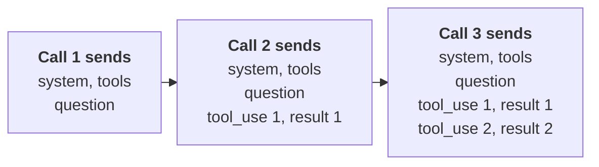

# Chapter 4: The Agent Loop

The most important code in this book is about a hundred lines long, and you write it in this chapter. Since exercise 2.6 your agent has had a ceiling: `ask` makes exactly two model calls, so any question that needs one tool's result before it can call the next fails. The agent loop removes that ceiling. Call the model, run the tools it asks for, send the results back, repeat until it's done. If that sounds too simple to be the heart of anything, hold the thought until you've watched it plan a route you never wrote.

**What you'll build:** the agent loop at the heart of every chapter that follows, with step limits, a tracer and a cost profile.

**You are here:** Agent runtime and Model in the agent architecture reference model (section 1.7).

**Prerequisites:** Chapter 2 (tool calling), Chapter 3 (the tool registry).

## Learning objectives

By the end of this chapter you can:

- Write a loop that runs until the model stops asking for tools.
- Handle several tool calls in a single model response.
- Stop an agent safely with an iteration cap.
- Trace every step and measure tokens and time.
- Write a system prompt that guides the model through the loop.

**In the real world.** Every agent product you've used, from coding agents to research assistants and support bots, runs some version of this loop. Once you've written it by hand, you'll recognize it inside any framework.

## 4.1 From two calls to a loop

A question like "How many days until July 4, and what weekday is it?" needs **two** tools in sequence. The agent first calls `get_current_date`, and only once it knows today's date can it call `days_between`. So instead of a fixed number of calls, keep going **while** the model keeps asking for tools:

@@code ch04_agent.py::get_client,next_action,run_agent

Read it slowly: every chapter from here on imports it. Each pass through the `for` loop does five things:

1. **Call the model** with the whole conversation and the tool list.
2. **Record** tokens and `stop_reason` in `stats`, and append the reply to `messages` unchanged.
3. **Decide** with `next_action`: the `stop_reason` is the model's request, and your code chooses what to do about it.
4. **Run every tool** the model asked for through `run_tool`, one `tool_result` each, with errors marked `is_error`.
5. **Send the results back** as one user message, check `should_stop` and go round again, until the cap ends the run.

The model chooses the tools, their arguments and when it's done. Your code runs the tools, counts the steps and enforces the limits, and nothing the model says can change those.

## 4.2 Walking through one run

For the July 4 question, a typical run looks like this (captured on 5 October 2026; your dates will differ):

Table: One run of the date agent, step by step
| Step | Model does | Your code does |
| --- | --- | --- |
| 1 | Calls `get_current_date` | Returns "2026-10-05 (Monday)" |
| 2 | Calls `days_between("2026-10-05", "2027-07-04")` | Returns "272 days; 2027-07-04 is a Sunday" |
| 3 | Writes the final answer, `stop_reason = end_turn` | Returns the text |

The model decided that July 4 of *this* year had already passed and chose next year. You didn't write that logic. The path was decided at run time from what the tools returned, and that is the whole difference between this and the fixed workflow of section 1.6. You've built an agent.

:::note What you should see
Run `./course.sh python ch04_agent.py`. The trace prints one line per tool call, then the answer and the counts. This run is from 5 October 2026; yours shows the day you run it:

```
[step 1] get_current_date({}) -> '2026-10-05 (Monday)'  (0 ms)
[step 2] days_between({"start": "2026-10-05", "end": "2027-07-04"}) -> '272 days; 2027-07-04 is a Sunday'  (0 ms)

ANSWER: It's 272 days until July 4, 2027, which will be a Sunday.
STATS: {'steps': 3, 'tool_calls': 2, 'input_tokens': …, 'output_tokens': …, 'stop_reason': 'end_turn', 'model': 'claude-sonnet-5'}
```

The wording, the token counts and sometimes the number of steps differ between runs and models, and that's normal. If your output looks stranger than that, it's probably one of these:
- **No `[step` lines, but an answer anyway**: the model guessed today's date, the failure from section 1.2. A system prompt that tells it to use the tools fixes it (section 4.10).
- **A tool result that starts with `ERROR`**: the model passed a badly formatted date. A good agent reads the error and retries, which is why errors go back to the model (section 2.6).
- **`Stopped: reached max_iterations`**: the model kept calling tools without finishing. It's rare with Claude and more common on the local model (section 4.4).
:::

## 4.3 Several tool calls in one turn

A model may request several tools in one response when the calls don't depend on each other: "Convert 10 miles to km and 5 kg to lb" can produce two `tool_use` blocks at once. `run_agent` loops over **every** `tool_use` block and returns **all** the results in one user message. Return only the first, and the API rejects the next request, because every `tool_use` needs a matching `tool_result`.

:::tip Parallel calls save time
Independent calls in one turn mean fewer round-trips. In Chapter 7 you'll run them at the same time with threads, which matters when each tool is a slow network call.
:::

## 4.4 Stop conditions

An agent must always know when to stop, and *why*. `next_action` reads the response's `stop_reason` and decides:

Table: Stop reasons and what `run_agent` does
| `stop_reason` | Meaning | What `run_agent` does |
| --- | --- | --- |
| `tool_use` | The model wants tools | Run them and loop |
| `end_turn`, `stop_sequence` | The model finished | Return the answer |
| `pause_turn` | A long server-side step paused | Send the conversation back to continue |
| `max_tokens` | The reply was **cut off** | Stop and say so |
| `refusal` | The model declined; `stop_details.category` says why (for example `cyber`) | Stop and say so; don't retry |
| `model_context_window_exceeded` | The conversation no longer fits | Stop; trim or compact it (Chapter 16) |

A common bug is `if stop_reason != "tool_use": return answer`. It treats a cut-off or refused reply as success. Every loop in this book uses `next_action` instead, and `stats["stop_reason"]` records how each run ended.

Besides the model's own stop, `run_agent` has an **iteration cap**: after `max_iterations` model calls, it gives up and says so. Without it, a confused model can call the same failing tool forever, and you pay for every call. An optional `should_stop` function, checked after every step, lets later chapters add more conditions:

Table: Stop conditions added in later chapters
| Condition | Chapter |
| --- | --- |
| Token or cost budget exceeded | 10 |
| No progress in N steps | 10 |
| Human rejects an action | 9 |
| Wall-clock timeout | 19 |

One more safeguard lives in `get_client`: a **120-second timeout** and **3 automatic retries** with backoff (a growing wait between attempts) for overloaded or rate-limited responses. Without a timeout, a stuck request could hang your agent for many minutes.

## 4.5 Tracing: see what your agent does

When an agent gives a wrong answer, the final text rarely tells you why. The **trace** does. `run_agent` prints each tool call, its arguments, a preview of its result and the elapsed time, and returns `stats` with the step count, tool calls and tokens. Most agent bugs fall into a few types you can spot there:

- **Wrong tool**: fix the description (Chapter 3).
- **Right tool, wrong arguments**: fix the schema or parameter descriptions.
- **Tool error ignored**: improve the error message.
- **Loop**: the same call repeats. Fix the tool or add a no-progress check.

:::tip Reading a trace
As an illustration, suppose a run of the July 4 question prints this:

```
[step 1] get_current_date({}) -> '2026-10-05 (Monday)'  (0 ms)
[step 2] calculate({"expression": "2027-07-04 - 2026-10-05"}) -> 'ERROR: SyntaxError: leading zeros in decimal integer literals are not permitted;'  (0 ms)

ANSWER: It's about 270 days until July 4, 2027.
```

Read it line by line, not just the answer. Step 1 is fine. Step 2 has two problems: the model picked `calculate` for a date question (the wrong tool), and the result starts with `ERROR`, yet the answer still gives a number. No tool produced "about 270", so the model guessed and hid the failure. That's an ignored tool error. Fix each where it lives. Make `days_between`'s description say to use it for any count of days between dates, and add that question to your routing eval (section 3.4). Then add a rule to the system prompt (section 4.10): if a tool returns `ERROR`, correct the call or say what failed, and never give a number no tool returned.
:::

## 4.6 Why history grows, and what it costs

Every step appends the model's response and the tool results to `messages`, and every model call resends the entire list. Step 5 pays for steps 1–4 again as input tokens, so `stats["input_tokens"]` grows much faster than the number of steps.



Figure: Every call resends the whole history, so input tokens grow with each step
Alt: Three model calls side by side. Call 1 sends the system prompt, the tools and the question. Call 2 sends all of that plus the first tool_use and its result. Call 3 adds the second tool_use and its result on top, so each call is longer than the one before.

Keeping it under control is mostly habit. Have tools return the 10 relevant rows, not 10,000. Cap iterations; most good runs finish in two to six steps. And print `stats` for every run while you develop, so you see the growth before your invoice does.

## 4.7 A multi-turn chat with the agent

Pass `run_agent` an existing `messages` list and the agent remembers earlier turns:

```python
from ch03_tools import TOOLS, run_tool
from ch04_agent import run_agent

history = []
while True:
    question = input("You: ")
    if question in ("quit", "exit"):
        break
    answer, history, stats = run_agent(question, TOOLS, run_tool,
                                       messages=history, verbose=False)
    print("Agent:", answer, f"  [{stats['tool_calls']} tool calls]")
```

## 4.8 Thinking and effort {api}

Current models reason before they answer or pick a tool, and you control how with request settings:

- **Thinking.** On Claude Sonnet 5 and newer models, **adaptive thinking is on by default**: the model decides for itself how much to think on each step. The reasoning arrives as `thinking` blocks at the start of `response.content`, with their text hidden by default (`display` is `"omitted"`). Pass `thinking={"type": "adaptive", "display": "summarized"}` to read a summary while you debug. On Claude Sonnet 5 you can switch thinking off with `thinking={"type": "disabled"}` for simple, high-volume calls; on the newest models (Claude Opus 5.5, Claude Sonnet 5.5 and the Fable and Mythos 5.1 models, as of October 2026) you can't. On all of these, the older `{"type": "enabled", "budget_tokens": N}` returns a 400 error.
- **Effort** (`effort="low"`, `"medium"`, `"high"`, `"xhigh"` or `"max"`, sent as `output_config={"effort": ...}`) is the main control for how hard the model works. The default is `"high"` on Claude Sonnet 5 (Claude Opus 5.5 defaults to `"medium"`). Low effort is plenty for simple lookups and costs less; measure the difference with exercise 4.5 before you pay for high effort everywhere.

```python
answer, messages, stats = run_agent(
    question, TOOLS, run_tool, effort="medium",
    thinking={"type": "adaptive", "display": "summarized"})
```

`run_agent` already handles thinking correctly, but you'll need these rules the day you write your own loop:

1. **Send thinking blocks back exactly as you received them.** They carry a signature (a code the API uses to confirm they're unchanged), and the API rejects a conversation where they were removed or edited. `run_agent` appends `response.content` whole; code that rebuilds the assistant message from only the text and tool calls breaks.
2. **Leave room in `max_tokens`.** Thinking counts toward `max_tokens` and is billed as output. A limit sized for the answer alone can run out mid-thought, ending with `stop_reason` `max_tokens` and no text. This book's code uses 2,000 to 4,096; you pay only for tokens used.
3. **Select blocks by type.** Never assume `content[0]` is the answer or the tool call.

## 4.9 Budgets for a whole task

`max_iterations` and `should_stop` (section 4.4) are budgets *your* code enforces. Two newer API features work closer to the model. A **task budget** (a beta feature on some models at the time of writing) tells the model roughly how many tokens the whole task may use, so it plans to fit instead of being cut off. **Claude Managed Agents** (Chapter 24) puts a hard spending cap on a session, which stops with a `budget_reached` reason. Keep your own caps anyway; they're the ones you can test.

## 4.10 Writing the system prompt

`run_agent` takes a `system` argument, and every agent from here on passes one. The system prompt is where you speak to the model directly, outside the conversation, and it shapes every step of the loop. A useful one answers five questions:

Table: The five parts of a system prompt
| Part | Question it answers | Example for this chapter's date agent |
| --- | --- | --- |
| Role and goal | Who is the model, and what is it for? | "You help people with questions about dates and times." |
| How to use the tools | When should it call which tool? | "Call `get_current_date` before answering anything about a relative date." |
| Rules | What must it always or never do? | "Never guess a date. If a tool fails, say so." |
| Output format | What should the answer look like? | "Answer in one sentence, with dates as YYYY-MM-DD." |
| When stuck | What should it do when it can't finish? | "If the question is ambiguous, ask one short question instead of guessing." |

As the agent grows, these habits keep its prompt working:

- **Say when, not only what.** "Use `calculate` for any arithmetic, even easy sums" works better than "You have a calculator."
- **Put hard rules in code as well.** A system prompt is advice the model usually follows; an iteration cap, a read-only database connection (Chapter 8) or an approval gate (Chapter 9) is a rule it can't break. Write the rule in the prompt so the model plans around it, and enforce it in code: the model proposes, code decides.
- **Change one thing at a time, and measure.** A new sentence can fix one question and break another. The measurement interlude after Chapter 8 shows how to tell which happened.

Section 16.10 returns to system prompts as a design skill.

:::note The support agent so far
The support agent gets the loop. "Where's my order, and can I still return it?" needs two lookups in a row: the order, then the return window for what was in it. With `run_agent` the agent chains them, while the iteration cap stops a confused run and the trace shows every step.
:::

## Common mistakes

- No iteration cap. A confused agent burns money in an infinite loop.
- Returning only the first tool result when the model asked for several.
- Not appending the assistant's `tool_use` message before the results. The API needs both, in order.
- Treating any non-`tool_use` stop as success. A `max_tokens` reply looks like an answer but is incomplete.
- Letting tool errors vanish. Send them to the model as data, and log every one.
- Rebuilding the assistant message by hand, which drops thinking blocks and breaks the next request.

## Before you move on

- **You should understand:** what each pass of the loop does, which parts the model decides (tools, arguments, when it's done) and which your code enforces (running tools, the cap, every `stop_reason`).
- **You should be able to build:** `run_agent` with an iteration cap, one `tool_result` per `tool_use` block and a trace line per tool call.
- **Prove it:** exercise 4.3 shows both the cap message and the model's reaction to a tool that always fails; exercise 4.4 prints tokens and time per step.
- **Break it on purpose:** return only the first `tool_result` for "Convert 10 miles to km and 5 kg to lb" and read the API's error.
- **Defend this decision:** why the iteration cap lives in code instead of a sentence in the system prompt.

## Key takeaways

**Architect's takeaway:** An unbounded loop is an unbounded bill. Set iteration caps and stop conditions before anything else.

- Always cap iterations; add budgets and no-progress checks later.
- Trace every step; the trace shows what went wrong (Appendix B has a debugging playbook).
- History is resent on every call, so input tokens grow fast; keep tool outputs small.
- A system prompt gives role, tool guidance, rules, output format and a plan for when stuck; hard rules go in code too.

## Learn more

| Resource | What you'll find |
| --- | --- |
| **Anthropic: Building effective agents**<br>[anthropic.com/engineering/building-effective-agents](https://www.anthropic.com/engineering/building-effective-agents) | When to use a loop, and how to keep it simple |
| **Claude docs: Handling stop reasons**<br>[platform.claude.com/docs/en/build-with-claude/handling-stop-reasons](https://platform.claude.com/docs/en/build-with-claude/handling-stop-reasons) | What each `stop_reason` means (including refusals) and what to do next |

## Exercises

:::ex Concept | 4.1 | Draw the loop
Draw a sequence diagram (boxes and arrows on paper is fine) for "How many days until July 4, and what weekday will it be?" Show the user, your code, the model and the tools, and label each message with its role and content type.
**Done when:** Your diagram shows at least two tool round-trips and the final answer.
:::

:::ex Simple | 4.2 | Run the loop
Run `ch04_agent.py`. Then ask three more multi-step questions of your own, such as "How many days from today until my birthday on March 3, and what weekday is it?"
**Done when:** Each question succeeds, and the trace shows at least two tool calls.
:::

:::ex Simple | 4.3 | Trigger the cap
Set `max_iterations=1` and run the July 4 question. Then add a tool `always_fails` that returns `ERROR: service unavailable` and ask a question that needs it.
**Done when:** You've seen both the cap message and how the model reacts to repeated errors.
:::

:::ex Medium | 4.4 | A better tracer
In `exercises/ex4_4_tracer.py` (not `ch04_agent.py`), print per step the input and output tokens and the model and tool time separately, then a summary table.
**Done when:** a run prints per-step timing and tokens and a final total.
---kit---
Extend the trace to print, for each step, input and output tokens plus the time spent in the model call and in tools, separately. At the end, print a summary table. Work in the copy of the loop that `./course.sh ex 4.4` creates (`exercises/ex4_4_tracer.py`), not in `ch04_agent.py`: every later chapter imports that file, so keep the original working.
**Hint:** Time the `messages.create` call and the `run_tool` calls with separate `perf_counter` pairs.
**Done when:** A run prints per-step timing and tokens and a final total.
:::

:::ex Complex | 4.5 | Cost profile
Run five questions of different difficulty 10 times each, recording steps, tool calls, tokens and wall time. Tabulate mean and max per question and chart input tokens against step number.
**Done when:** you can state, with numbers, how cost grows with steps.
---kit---
Run five questions of different difficulty 10 times each. Record steps, tool calls, input tokens, output tokens and wall time. Produce a table with the mean and max for each question, and a chart of input tokens against step number.
**Hint:** Store results in a list of dictionaries and use `statistics.mean`. For the chart, use matplotlib or a spreadsheet.
**Done when:** You can state, with numbers, how cost grows with steps, and which question is the most expensive and why.
:::

## Checkpoint: end of Part 1

Before starting Part 2, check that you can, without looking back:

- [ ] Explain the difference between a single call, a workflow and an agent, with an example of each.
- [ ] Write a tool: a function plus a name, a description and a JSON Schema.
- [ ] Explain why a tool result is sent with `role: "user"` and what `tool_use_id` is for.
- [ ] Write the agent loop from memory, including the iteration cap.
- [ ] Read a trace and say whether a failure was the wrong tool, wrong arguments or an ignored error.

If two or more are shaky, redo exercises 2.3, 3.4 and 4.2 before moving on.

:::note Ready for Part 2?
Chapters 5 and 6 list Chapter 4 as their prerequisite, and the regular-expressions interlude asks for Chapter 0 and the Python interlude. In practice, Part 2 assumes three skills:
- **Calling `run_agent` with your own tools and `run_tool`.** Section 4.1 and exercise 4.2.
- **A tool registry whose `run_tool` returns `ERROR:` text instead of raising.** Section 3.1 and exercise P.2.
- **Working with Python strings**, which the regular-expressions interlude builds on. Chapter 0's Python tour and the Python interlude.

If one of these is shaky, redo its exercise before Chapter 5. Both chapters run their agents with `run_agent`.
:::

## Up next

Part 1 ends here, and it's a real milestone: you've written by hand the loop every later chapter builds on. Its only memory is the `messages` list, which lasts exactly as long as your program does; Chapter 5 gives it state that survives a restart.
