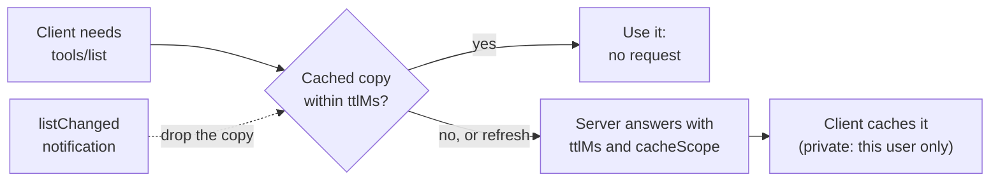

# Chapter 15: MCP in 2026: From Tool Calling to Agent Infrastructure

Connect fifty MCP servers to a host that asks for the tool list before every model call, and a twenty-turn conversation sends a thousand list requests, nearly all returning what the last one did. Put those servers behind a load balancer and the old sessions break too. The 2026-07-28 specification fixed both: every request now stands on its own, clients cache what servers tell them, and optional features moved into extensions.

**What you'll build:** a server that tells clients how long to cache its lists, a client that inspects any server, and raw HTTP requests that show the stateless protocol.

**You are here:** MCP and Policies in the agent architecture reference model (section 1.7).

**Specification:** like the rest of Part 5, this chapter teaches the 2026-07-28 MCP specification; the note at the start of Chapter 12 says which details may change and where to check.

**Prerequisites:** Chapters 12–14 (MCP).

## Learning objectives

By the end of this chapter you can:

- Explain what the 2026-07-28 specification changed and which problem each change solves.
- Send MCP requests over HTTP without an SDK, and say what each header and `_meta` field is for.
- Set cache hints on a server and measure what caching saves.
- Explain the extensions framework, and plan a move away from the deprecated features.

**In the real world.** In December 2025, Anthropic donated MCP to the Agentic AI Foundation, a new Linux Foundation project, alongside OpenAI's AGENTS.md and Block's goose. The 2026-07-28 specification is a major revision, and most of its changes came from production users: cloud providers, security teams and busy hosts.

## 15.1 From tool calling to infrastructure

With one agent and three servers, the Chapter 13 host is all you need. With fifty, new problems appear:

Table: Problems of running many servers, and the answers MCP gives
| Problem | Answer | Section |
| --- | --- | --- |
| A server runs on many machines behind a load balancer | Stateless requests | 15.2 |
| Every model call asks every server for its tools again | Cache hints on lists | 15.3 |
| Optional features bloat every client and server | Extensions, used only when both sides support them | 15.4 |
| Some tools take minutes, and connections time out | Start-and-poll jobs; the Tasks extension | 30.8 |
| Hundreds of tools don't fit in a prompt | Progressive discovery through search | 30.9 |
| Nobody can say which agent may call which tool | A gateway with allow-lists, tokens and one audit trail | 30.9 |
| Anyone can publish a server | Registries with verified publishers, plus your allow-list | 30.10 |
| Every employee approves every server by hand | Enterprise-managed authorization | 30.11 |

None of this touches the three primitives from Chapter 12: tools, resources and prompts work exactly as before. What changes is the machinery around them.

## 15.2 The protocol on the wire {api}

Before 2026-07-28, a client opened a *session*: an `initialize` handshake, then an `Mcp-Session-Id` header on every later request, so one server process had to answer them all. The 2026-07-28 revision retired both. Now **every request is complete on its own**: it carries the protocol version and the client's capabilities in its `_meta` field, and any copy of the server can answer it. Anyone who has run sticky sessions knows the failure: the one machine holding the sessions dies and takes every conversation with it. This is the change worth celebrating first.

You can see this with plain HTTP. Start the chapter's catalog server with `./course.sh serve ch15_modern.py`, then send it requests:

@@code ch15_modern.py::ENVELOPE,post

A call to `get_price` is one POST, and this is all of it:

```
POST /mcp
MCP-Protocol-Version: 2026-07-28
Mcp-Method: tools/call
Mcp-Name: get_price

{"jsonrpc": "2.0", "id": 1, "method": "tools/call",
 "params": {"name": "get_price", "arguments": {"product_id": "P-2"},
            "_meta": {"io.modelcontextprotocol/protocolVersion": "2026-07-28",
                      "io.modelcontextprotocol/clientCapabilities": {}}}}
```

And the answer:

```
{"jsonrpc": "2.0", "id": 1, "result": {"content": [{"type": "text", "text": "120.0"}],
 "structuredContent": {"result": 120.0}, "isError": false, "resultType": "complete"}}
```

With no handshake, the first request can be a tool call; one without the `_meta` envelope is rejected. The headers repeat the method and tool name, so a gateway can route, rate-limit or block `tools/call` for `delete_repo` without parsing JSON, and the Python SDK's server refuses a request whose headers and body disagree, so nobody can slip a different tool past a gateway that trusted the header. And `resultType` says whether this is the final answer (`complete`) or a request for more input (`input_required`, as in Chapter 13's elicitation exercise).

To learn what a server offers before calling it, a client sends **`server/discover`** and gets back the protocol versions, capabilities, extensions and instructions. It's optional; a client that already knows the server skips it.

:::tip Sessions still exist where you need them
A shopping cart or a database transaction still needs state. Keep it in your own storage, keyed by an id you return from a tool, the way Chapter 5 keeps the to-do list in a file. Only the protocol-level session went away.
:::

## 15.3 Discovery and caching

Since 2026-07-28, list results and resource reads carry two hints: **`ttlMs`**, how many milliseconds the answer stays fresh, and **`cacheScope`**, whether one user's cached copy may be served to another (`public`) or not (`private`). The Python SDK sets them from `cache_hints`:

@@code ch15_modern.py::catalog

A tool list that changes only when you deploy can be `public` for minutes. A resource list that depends on who's asking must be `private`, or one user's cached list leaks another's file names. The SDK's client caches automatically and respects the hints:

@@code ch15_modern.py::describe

Run `./course.sh python ch15_modern.py`:

```
     protocol: 2026-07-28
...
       ttl_ms: 300000
  cache_scope: public
 list_changed: True
  same_answer: True
list requests that reached the server: 1
```

Two list calls, one request to the server. When the list does change, a server that declares `listChanged` notifies listening clients and they drop their copy early; a client can also force a fresh one with `cache_mode="refresh"`. Exercise 15.4 measures the saving over a conversation.



Figure: How a client uses the cache hints
Alt: The client needs the tool list and checks for a cached copy still within ttlMs. If there is one, it uses it without a request. If not, or when forced to refresh, the server answers with ttlMs and cacheScope and the client caches the answer, for this user only when the scope is private. A listChanged notification drops the cached copy.

The hints are only advice. The Python SDK's client honors them, but another client may not cache at all. So a server must answer correctly every time, and never rely on a `private` hint alone to keep users apart.

## 15.4 Extensions and the road ahead {api}

The 2026-07-28 revision also introduced an **extensions framework**. The core protocol stays small; optional features live in extensions with names like `io.modelcontextprotocol/tasks`. A client lists its extensions in each request's capabilities, a server lists its own in `server/discover`, and a feature is used only when both sides have it. Tasks (section 30.8), MCP Apps (interactive user interfaces inside the chat, Chapter 12) and Enterprise-Managed Authorization (section 30.11) are the first official extensions.

### What's protocol, what's optional, what's the SDK

**The protocol** defines the `_meta` envelope, the `Mcp-Method` and `Mcp-Name` headers, `resultType`, the `ttlMs` and `cacheScope` fields and how extensions are negotiated. **Optional** are calling `server/discover` (servers must answer it), honoring cache hints (servers must send them), `listChanged` notifications and every extension; a host that has never heard of Tasks still works with a server that offers it. **The Python SDK** adds the `cache_hints` argument, the client cache and `cache_mode`, the fallback to `initialize` for older servers and the refusal of mismatched headers. Another SDK speaks the same protocol; check which of those conveniences it gives you.

Three older features, a transport and a way of registering clients are now **deprecated, not removed**. They keep working for at least twelve months, but new implementations shouldn't adopt them:

Table: MCP features deprecated as of 2026-07-28, and their replacements
| Deprecated (still supported) | Use instead |
| --- | --- |
| Sampling (the server borrows the host's model) | The server calls a model API itself, with its own key and budget |
| Roots (the client lists allowed folders) | Folders as tool parameters or resource URIs, checked by the server |
| Logging over the protocol | stderr, or OpenTelemetry traces (Chapter 28) |
| The HTTP+SSE transport | Streamable HTTP |
| Dynamic Client Registration | Client ID Metadata Documents (section 30.11) |

MCP's roadmap, published on 22 August 2026, sets five priorities. Roadmaps change, so check the current one before you plan around it:

1. **Messaging for long-running agent work:** tasks, subscriptions and progress for agents that run for hours.
2. **One HTTP-native transport** for local and remote servers.
3. **Agent identity**, which section 30.11 returns to after Chapter 26.
4. **Better primitives**, including progressive discovery (section 30.9) in the protocol itself.
5. **Better SDKs** and developer experience.

MCP is becoming the way agents reach everything a company runs, held to the same standards as any production API: scale, security, identity and audit. Chapter 30 builds each in a small, readable form once you have durable jobs (Chapter 19), agent identity (Chapter 26) and tracing (Chapter 28).

## Common mistakes

- Keeping state in memory and expecting the same server process to answer next time.
- Caching private lists as public, so one user's resource names reach another.
- Trusting the `Mcp-Name` header without checking the body.
- Building new servers on deprecated features such as sampling or roots.

## Before you move on

- **You should understand:** why a request that carries its own version and capabilities lets any copy of a server answer it, and which 2026-07-28 changes are required protocol, which are optional and which the Python SDK adds.
- **You should be able to build:** a server whose lists carry `public` or `private` cache hints, and raw HTTP requests to it without an SDK.
- **Prove it:** exercises 15.3 and 15.4.
- **Break it on purpose:** send a `tools/call` with `post` after deleting its `_meta` envelope, and read how the server rejects it.
- **Defend this decision:** where a stateful feature such as a shopping cart keeps its state when the protocol has no session, and what id ties a request to it.

## Key takeaways

**Architect's takeaway:** Design servers so any copy can answer any request, and keep per-user state in your own storage; that's what lets MCP run behind ordinary infrastructure.

- Headers repeat the method and tool name for gateways, and servers reject requests whose headers and body disagree.
- `ttlMs` and `cacheScope` let clients cache lists, saving a request on nearly every model call.
- Optional features live in extensions; sampling, roots, protocol logging and HTTP+SSE are deprecated but keep working for at least a year.
- Sections 30.8 to 30.11 build jobs, gateways, registries and company sign-on on top of these changes.


## Learn more

| Resource | What you'll find |
| --- | --- |
| **MCP blog: The 2026-07-28 specification**<br>[blog.modelcontextprotocol.io/posts/2026-07-28](https://blog.modelcontextprotocol.io/posts/2026-07-28/) | Every change in this chapter, from stateless requests to deprecations |

## Exercises

:::ex Concept | 15.1 | Who asked for this?
For each 2026-07-28 change, name who benefits and what went wrong before it: (a) stateless requests; (b) `Mcp-Method` and `Mcp-Name` headers; (c) `ttlMs` and `cacheScope`; (d) the extensions framework.
**Done when:** Each change has a beneficiary (server operator, load balancer, host, user) and a concrete problem it solves.
:::

:::ex Concept | 15.2 | Plan a migration
Plan the migration of a 2025 server (sampling, roots, protocol logging, HTTP+SSE, per-user state in memory) to the 2026-07-28 specification: what changes, in what order, how you test it.
**Done when:** every deprecated feature replaced, state rehomed, first shipment named.
---kit---
An internal server written in 2025 uses sampling to summarize documents with the host's model, roots to learn which folders it may read, protocol logging and the HTTP+SSE transport. It also keeps each user's search results in memory between calls. Write the migration plan to the 2026-07-28 specification: what changes, in what order, and how you'll test that nothing broke.
**Done when:** Every deprecated feature has a replacement, the in-memory state has a new home, and the plan says what to ship first.
:::

:::ex Simple | 15.3 | MCP by hand
Start `./course.sh serve ch15_modern.py`. Using `post` from `ch15_modern.py`, send `server/discover`, `tools/list` and a `tools/call` for `get_price`. Then send a request whose `Mcp-Name` header names a different tool from the body.
**Done when:** You can point to the protocol version, the cache hints and the structured result in the answers, and you can explain why the mismatched request is refused.
:::

:::ex Medium | 15.4 | What does caching save?
A host lists tools before every model call. Using `CountingServer`, count how many list requests reach the server over ten turns: with the five-minute hint and caching on, with the cache bypassed, and with the hint set to zero.
**Done when:** You have three counts, and one sentence on when a server should choose a short hint or `private` scope.
:::

## Checkpoint: end of Part 5

- [ ] Package tools as an MCP server with tools, resources and prompts, and test it in Inspector.
- [ ] Write an MCP host that discovers tools from several servers and routes calls.
- [ ] Publish an agent as an MCP server and have a coordinator delegate to it.
- [ ] Let a server ask the user for missing details (elicitation).
- [ ] Evaluate a third-party MCP server and narrow its permissions.
- [ ] Build a policy layer with allow-lists, approvals and an audit log.
- [ ] Send MCP requests by hand, and set cache hints on a server.

:::note Ready for Part 6?
Part 6 turns from reaching tools to choosing what the model sees, and it doesn't need Part 5. Its chapters assume:

- **State that outlives a session** (section 5.1, exercise 5.1). Chapter 17 builds on that line between conversation and stored state.
- **Keeping large results out of the context, and citations** (sections 6.4 and 6.5, exercise 6.4). Chapters 16 and 18 extend both.
- **Repeated runs with a margin of error** (the measurement interlude, exercise M.2). Exercise 18.6 uses its `run_suite`, and section 18.6 warns that small evaluations can't separate close results.

Without the interlude you can build everything in Part 6 but can't tell whether a change helped.
:::

## Up next

There's a cost hiding in all this reach. Every tool result, document and turn an agent collects ends up in one place, the context window, and on a long task it fills faster than you'd expect. With fifty servers available, the hard problem is no longer whether the agent can get the information but which of it the model should see. Part 6 starts there: Chapter 16 decides what goes into every call, Chapter 17 adds memory with rules, and Chapter 18 builds knowledge the agent can search and check.
