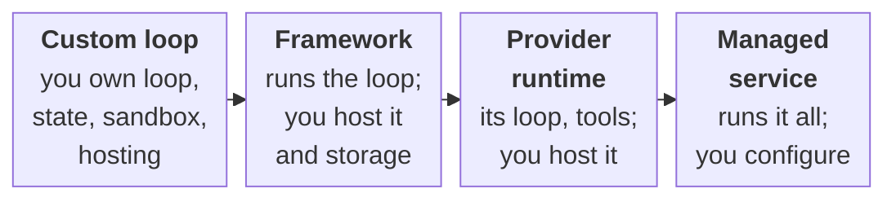

# Chapter 24: Skills, Frameworks and Agent Runtimes

Open any agent framework's concepts page and, to a newcomer, it reads like a glossary for a foreign language: sessions, hooks, middleware, checkpointers, subagents, permission callbacks. You won't have that problem. Each of those words now names something you've written by hand, from the loop in Chapter 4 to the browser harness in Chapter 23, so you can read any framework's documentation the way a mechanic reads a parts list and decide which runtime, if any, earns its place.

**What you'll build:** the same agent with the Claude tool runner, the Agent SDK, LangChain and Managed Agents, plus a skill of your own and an evaluation that shows whether it helps.

**You are here:** Agent runtime in the agent architecture reference model (section 1.7).

**Prerequisites:** Chapter 4 (agent loop), Chapter 9 (approval gates), Chapters 12–13 (MCP), Chapter 17 (memory), the measurement interlude.

## Learning objectives

By the end of this chapter you can:

- Map your hand-built agent onto a framework's features.
- Replace your loop with the Anthropic SDK's tool runner.
- Build an agent with the Claude Agent SDK, with permissions and limits.
- Build a model-agnostic agent with LangChain's `create_agent`.
- Decide between building by hand and using a framework.
- Package know-how as an Agent Skill, test it, and release it like software.
- Run an agent on Claude Managed Agents, and choose a runtime.

**In the real world.** Most production teams use a framework, a library that supplies the plumbing so you write less of it. The Claude Agent SDK is the runtime behind Claude Code, packaged for your own agents; LangChain and LangGraph are popular model-agnostic alternatives.

## 24.1 The same ideas, different names

Table: Your hand-built agent in three frameworks
| You built | Tool runner (Anthropic SDK) | Claude Agent SDK | LangChain `create_agent` |
| --- | --- | --- | --- |
| The loop (ch 4) | `tool_runner(...)` | `query(...)` | `agent.invoke(...)` |
| Tool + JSON Schema (ch 2) | `@beta_tool` on a function | `@tool(name, description, schema)` | A plain function with a docstring |
| Iteration cap (ch 4) | `max_iterations` | `max_turns` | Recursion limit / call-limit middleware |
| Budget (ch 10) | Your own check | `max_budget_usd` | Model-call limit middleware |
| Approval gate (ch 9) | Your own check | `can_use_tool` callback, hooks | Human-in-the-loop middleware |
| MCP servers (ch 13) | `mcp_servers` (remote) | `mcp_servers`, in-process or stdio | Adapters |
| Memory / compaction (ch 16) | Your own code | Sessions, compaction built in | Checkpointers, summarization middleware |
| Resume after a crash (ch 19) | Your own code | Sessions you can resume | Checkpointers (LangGraph) |
| A model per step (ch 20) | `model` on each call | A model per agent or subagent | A model per node |
| Subagents (ch 21) | Your own code | Subagents | Multi-agent graphs |

You've written every row yourself, so none of these names should puzzle you.

## 24.2 The tool runner: your loop, built in {api}

@@code ch24_tool_runner.py::days_between,ask

`@beta_tool` reads the function's type hints and docstring (including the `Args:` section) to build the JSON Schema you wrote by hand in Chapter 2. `tool_runner` calls the model, runs the tools it asks for, sends the results back and repeats, up to `max_iterations`: Chapter 4's `run_agent` in one call. Iterating over the runner gives you each model response as it happens, so tracing still works.

## 24.3 The Claude Agent SDK {api}

@@code ch24_agent_sdk.py::approve,OPTIONS,ask

The Agent SDK runs a full agent runtime in a separate process and talks to it for you. Look at what the listing sets up.

The tools run in your program. `@tool` functions are served by an in-process MCP server (`create_sdk_mcp_server`) under names like `mcp__shop__run_query`, Chapter 13's namespacing.

The agent is isolated. `tools=[]` turns off the built-in tools (file editing, shell, web), `strict_mcp_config=True` ignores MCP servers configured elsewhere, and `setting_sources=[]` ignores settings files. Leave these out and the agent can pick up capabilities you never gave it.

Permissions go through your code. Tools in `allowed_tools` are approved automatically; every other call goes to `can_use_tool`, Chapter 9's approval gate as a callback. Here `get_schema` is auto-approved, and `run_query` is allowed only for `SELECT` statements.

Limits are built in: `max_turns` is the iteration cap, `max_budget_usd` stops the run at a dollar amount, and the final `ResultMessage` reports turns and cost.

:::warn allowed_tools skips your approval callback
A tool listed in `allowed_tools` is approved **before** `can_use_tool` is consulted, so your callback never runs for it (the SDK prints a `CanUseToolShadowedWarning`, expected here for `get_schema`). Put only harmless tools there, and route everything else through the callback or a `PreToolUse` hook.
:::

In the Agent SDK version the kit pins (`claude-agent-sdk` 0.2.159, in `requirements.lock`), the callback needs the prompt as a stream of messages ("streaming input"), so `ask` passes `_prompt(question)` rather than a plain string. If you use another version, check its documentation.

## 24.4 LangChain: model-agnostic agents {api}

@@code ch24_langchain.py::add_task,build,ask

`create_agent` turns plain functions into tools (the docstring is the description), runs the loop on LangGraph and returns the full message history. Swap `ChatAnthropic` for another provider's chat model and nothing else changes. That portability is the main reason to choose it, along with middleware (pluggable steps around each model or tool call) for summarization, call limits and human approval.

## 24.5 Build or buy?

Table: Build by hand or use a framework {#t:build-or-buy}
| Build by hand when… | Use a framework when… |
| --- | --- |
| You're learning, or the agent is small | The agent needs sessions, compaction, subagents or hooks you'd otherwise write |
| You need full control of every request | You want well-tested plumbing and fewer lines to maintain |
| Dependencies must be minimal | Your team already uses the framework |

Either way, tool design, approval gates in code, evaluations and cost tracking still apply. A framework changes how much code you write, not what good looks like.

## 24.6 Using other model providers {api}

Every example in this book uses Claude, but almost nothing depends on it. Tool-calling models from OpenAI, Google, Mistral or open-weight families follow the same pattern: you send messages and tool definitions, the model asks for a tool, and your code runs it and returns the result.

Table: What carries over between model providers
| Carries over unchanged | Differs between providers |
| --- | --- |
| The agent loop, iteration caps and budgets | How tool calls and results are wrapped in messages |
| Tool design: names, descriptions, JSON Schema, errors as text | Stop-reason and tool-choice names |
| Approval gates, sandboxes, policies and the lethal trifecta | Caching, thinking and structured-output options |
| Evaluation suites, judges and load tests | Prices, rate limits and context sizes |
| MCP servers and clients (MCP is vendor-neutral) | Built-in tools |

You can switch in several ways, from least to most work:

1. **Use a framework's model interface.** In `ch24_langchain.py` it's a one-line change (section 24.4).
2. **Keep model calls behind one function.** This book's code already does: every chapter gets its client from `get_client()` in `ch04_agent.py` and reads the reply in one place, `next_action`. A small adapter that translates messages, tools and replies leaves the rest of your agent unchanged.
3. **Use an OpenAI-compatible endpoint** if your provider or model server offers one.

The kit uses one more. If a model server speaks the Anthropic Messages API, point the SDK at it with `ANTHROPIC_BASE_URL` and fill any gaps with a small proxy. That's how the free local model in Appendix H works: Ollama serves `qwen3.5:9b`, and `course/local_adapter.py` translates forced tools and structured outputs for it.

Then rerun your evaluation suite (the measurement interlude's `run_suite` is enough to start). Models differ in how eagerly they call tools and how closely they follow descriptions, and only measurement tells you whether the new one is as good for *your* agent.

## 24.7 Agent Skills: packaging know-how {api}

A **skill** is a folder that teaches an agent one kind of task: a `SKILL.md` file with a name, a one-line description and instructions, plus optional `scripts/`, `references/` and `assets/` folders. It started at Anthropic and is now an open format (agentskills.io) read by Claude Code, the Claude Agent SDK, the Claude API and many other agents.

The design is **progressive disclosure**: context engineering (Chapter 16) as a file format. The agent sees only each skill's description (about 100 tokens) until a task matches. Then it reads the instructions, and loads a reference file or script only if they mention one. A hundred installed skills cost a few thousand tokens until one is needed.

:::tip On the free local model
Writing a skill needs no model at all, but running one through the Claude API (`ch24_skills.py`, exercise 24.6) uses Anthropic's code-execution container, so it needs Claude (`PROVIDER=claude`).
:::

This file checks skills against the specification and gives your Chapter 4 agent the same behavior with one extra tool:

@@code ch24_skills.py::parse_skill~,validate,catalog,read_skill,system_prompt

The validator enforces the specification's rules. `name` is 1–64 lowercase letters, digits and single hyphens, and matches the folder name. `description` says **what the skill does and when to use it**, in at most 1,024 characters; it's the only part the model sees up front, so write it like a tool description. Keep `SKILL.md` under 500 lines and move details into `references/`.

A skill is **procedural memory that people wrote down and reviewed** (Chapter 17): a person writes it, a teammate reviews it, and version control records every change. That makes skills the safe home for "how we do things here", and it means a skill deserves testing like code. The test that counts is whether the agent does the task better with it than without it, which exercise 24.8 measures.

:::warn A skill is code you're choosing to trust
A skill can tell an agent to run its scripts. Treat a third-party skill like a third-party MCP server (section 14.3): read it before installing, pin the version and give the agent no more permissions than the skill needs. Section 24.10 turns this into a process.
:::

## 24.8 Claude Managed Agents: renting the whole runtime {api}

The tool runner and the Agent SDK still run the loop on *your* machine. **Claude Managed Agents** runs it on Anthropic's. You define an agent (model, system prompt, tools, MCP servers, skills) and an **environment** (a sandbox with its own file system and network rules), then start **sessions**. The agent works in the sandbox with built-in tools like bash and web fetch, and your code follows a stream of events.

*Needs Claude:* Claude Managed Agents runs on Anthropic's servers, so on the local model this section's exercise stops with a clear message (Appendix H).

@@code ch24_managed_agent.py::AGENT,handle,run~

Everything you built is still there, under new names:

Table: What you built, in Managed Agents
| You built | In Managed Agents |
| --- | --- |
| The loop and its tools (Chapters 4, 6, 10) | Runs on the server; the built-in toolset is `agent_toolset_20260401` |
| Tools that must stay local (Chapter 8's database) | **Custom tools**: the session pauses until your code sends `user.custom_tool_result` |
| Approval gates (Chapter 9) | **Permission policies** per tool: `always_allow`, `always_ask` (you answer with `user.tool_confirmation`) or `auto` |
| Sandbox and network rules (Chapters 10 and 14) | The **environment**: `limited` networking with an allow-list of hosts |
| Budgets (Chapters 4 and 10) | A hard **session budget**; the session stops with `budget_reached` |
| Memory (Chapter 17) | **Memory stores** mounted into sessions |
| Multi-agent teams (Chapter 11) | A coordinator agent with a roster of subagents |

Choose it for long-running agents that need a real sandbox you'd rather not operate. Build by hand when you must run on your own infrastructure or control every request. The event, policy and stop-reason names in the table are the ones the kit's code uses with the beta Managed Agents API (`client.beta`) in the `anthropic` 1.8.0 SDK that `requirements.lock` pins. Managed Agents was a public beta when this book was written, so check the documentation for current names.

## 24.9 Choosing a runtime

Part 7 added things a simple loop doesn't give you: surviving crashes, plans and model routing, teams, hard controls and sandboxes. A **runtime** is whatever runs your agent and provides them.

Table: Agent runtimes compared
| Runtime | Where the loop runs | What you get | What stays your job |
| --- | --- | --- | --- |
| Your own loop (this book) | Your code | Full control, no dependencies | Everything in Chapters 19–23 |
| The tool runner | Your code | The loop, with less code | Durability, teams, controls |
| The Claude Agent SDK | Your machine or container | Sessions, subagents, hooks, permissions, built-in tools | Hosting, cross-machine durability, evaluation |
| LangGraph and similar | Your code | Graphs, checkpointers, many providers | Storage, controls |
| A durable-execution platform | Your workers | Crash-proof steps, retries, timers, waiting for people | The agent logic itself |
| Claude Managed Agents | Anthropic's servers | Sandboxes, sessions, permissions, budgets, memory stores | Local tools, evaluation |

Whichever option you're weighing, ask the same questions:

- Where does state live, and does a session survive a crash?
- How are approvals and hard rules expressed, and can the model get around them?
- Can you see every model call, tool call, token and dollar?
- Where does code run, and what can it reach?
- What does it cost at your volume, and what would moving away cost?

The four columns are a custom loop (this book's), a framework that manages the agent (LangGraph or LangChain), a provider-specific runtime (the Claude Agent SDK) and a managed service (Claude Managed Agents).

Table: Choosing how to run an agent (as of October 2026)
| | Custom loop | Framework | Provider runtime | Managed service |
| --- | --- | --- | --- | --- |
| Control | Every request and step | You shape the graph; it runs the loop | The provider's loop, steered by options and callbacks | You configure; the provider runs loop and sandbox |
| Portability | Any provider, behind one function | Many providers through one model interface | One provider's models | One provider's models and servers |
| Observability | Whatever you log | The full message history, plus your own logs | Messages and a result with turns and cost | A stream of session events |
| Deployment effort | Highest: you build durability and controls | You host it and its storage | You host the process | Lowest: no servers |
| Vendor dependency | The model API only | The framework's releases | The provider's SDK and models | Runtime, sandbox and memory stores |
| Cost | Tokens plus engineering time | Tokens plus upgrades | Tokens, with built-in budget caps | Tokens plus the service's pricing, within a session budget |



Figure: From your own loop to a managed service: each step right hands someone else more of the stack
Alt: Four options left to right. A custom loop leaves the loop, state, sandbox and hosting to you. A framework runs the loop while you host it and its storage. A provider runtime brings the provider's loop and tools while you host the process. A managed service runs the loop and sandbox for you, and you only configure it.

These rows are lasting differences: who runs the loop, where state and code live, how much of the stack someone else owns. Option names, built-in tools and defaults change with each SDK release. Appendix J maps the runtimes onto other platforms, and `VERSION_MATRIX.md` in the course kit lists the versions tested here.

The runtime listings in this chapter are learning demos; don't build on them. A common path: prototype with your own loop, move the agent logic onto the Agent SDK or a framework once the design settles, and put anything long-running inside a durable runner.

## 24.10 Skills as software

Reviewed procedural memory is enough for a handful of skills. Once several teams write them, it isn't, because small edits have large effects. Change one word in a description and the agent stops loading the skill. Change one line in its references and the agent writes different SQL. And a skill can run scripts. So **a skill is executable agent knowledge, and it should be evaluated, versioned, secured and deployed like software.**

Here's where a skill sits among the other things that steer an agent:

Table: Tools, prompts, skills, workflows and agents {#t:skill-kinds}
| | What it is | Who decides what runs | How you test it |
| --- | --- | --- | --- |
| **Tool** (`run_query`) | A function with a schema | The model picks it; your code runs it and checks arguments | Unit tests, plus tool-selection cases (Chapter 3) |
| **Prompt** | Text sent with every request | Nothing runs; it steers every answer | The agent's eval suite (Chapter 27) |
| **Skill** (`sql-report`) | Instructions, references and scripts, loaded when a task matches | The model loads it from its description | Trigger cases, and with-or-without comparisons (exercise 24.8) |
| **Workflow** (section 22.2) | Fixed steps in code, some calling a model | Your code | Tests on states and transitions, model steps scripted |
| **Agent** | A model in a loop choosing tools | The model, inside limits your code sets | Suites with trials, trajectory checks, a scorecard |

The skill row is the odd one. Like a prompt it's text, so you can't unit-test it. Like a tool it's chosen by the model, so a bad description makes it disappear. Like a library it has authors, versions and dependencies, and like an MCP server it comes from someone you must decide to trust. So it needs its own lifecycle:

1. **Write and validate** the folder, with **eval cases** under `evals/` so the tests travel with the skill.
2. **Publish** an immutable `NAME@VERSION` with a **manifest** listing its version, description, dependency ranges, permissions, author and content hash. The last two are its **provenance**.
3. **Review and assign a trust level.** Reviewers set it, and each level allows a fixed set of permissions.
4. **Gate the release.** A new version ships only if it passes its own cases *and* the previous version's.
5. **Resolve and lock** one version of each skill, pinning versions and hashes in a lockfile.
6. **Install** only what matches its hash and fits its trust level.
7. **Compose** with an explicit priority when two skills disagree.
8. **Roll back** by withdrawing the bad version, so the previous one is current again.

`ch24_skill_registry.py` builds each step. The registry is a folder, `registry/NAME/VERSION/`, plus an index of which versions passed the gate and which were rolled back. Here's the install and resolve side:

@@code ch24_skill_registry.py::TRUST_ALLOW,install,resolve~,compose

Each check stops a specific failure. The hash covers every path and every file's content, so if someone edits the schema notes after publishing, the install refuses. It's section 14.3's rug-pull check, applied to a skill's text. Permissions are checked against the trust level, not against what the skill says it needs. A community skill gets `read_skill` and nothing else, however reasonable its request for `send_email` sounds. `resolve` refuses to guess. If `sql-report` needs `shop-schema ^1.0` and `customer-lookup` needs `^2.0`, the error names who asked for what. And `compose` needs an explicit priority. Skills declare their decisions as **directives** (`table.order: largest first`), and when two disagree, code picks the winner and tells the model only the decision.

And the release side:

@@code ch24_skill_registry.py::static_eval~,gate,promote,rollback~

`static_eval` is deliberately simple. A case says whether a question should load the skill and what text the skill must contain. "Should load" here means the question shares at least two content words with the description, a stand-in for the model's choice. That's enough to catch the most common regression, which is someone "tidying" the description. To measure task quality, pass `promote` an `eval_fn` that runs the agent, as exercise 24.8 does.

Run `./course.sh python ch24_skill_registry.py`. It works in a temporary folder, with no model:

```
1. Publish, then promote through the regression gate
   sql-report@1.0.0: PROMOTED (3 cases, against None)
   sql-report@1.1.0: REFUSED (3 cases, against 1.0.0)
      failed: 'Give me a revenue report by product category.': loads=False, expected True
      ...
   sql-report@1.2.0: PROMOTED (4 cases, against 1.0.0)
   current: sql-report@1.2.0

...
   REFUSED: web-digest@0.3.0 (community) asks for ['send_email'], beyond what that trust level allows
   REFUSED: shop-schema@1.0.0: content hash mismatch, the files changed after they were published. Refusing to install.
...

5. Roll back
   an incident with sql-report@1.2.0: rolled back, current is now 1.0.0
   the old lockfile: sql-report@1.2.0 is rolled back; install a released version
   re-lock: sql-report@1.0.0
```

Version 1.1.0 is the instructive failure. Its new description, "Formats query results as Markdown tables", reads better, but it no longer mentions revenue or reports, so the agent would stop loading it for the questions it exists to answer. The previous version's cases catch that before any user does. The rollback also reaches pinned installs, so a lockfile that still names 1.2.0 is refused until you re-lock.

For versioning, a good default is a new **major** version for anything that changes what the agent may do or what callers get back, such as new permissions, a different output format or a removed trigger. Use **minor** for new abilities and **patch** for wording that keeps every case passing. Exercise 24.10 enforces the first rule.

:::note What production adds
- **Signatures.** A hash proves the files haven't changed, not who published them. Sign each manifest (Sigstore or your own keys) and verify at install.
- **A private registry** of reviewed skills only, as section 30.10 describes for MCP servers.
- **Staged rollout.** Shadow and canary a new version, roll back by configuration (section 30.13), and record skill versions in every trace.
- **Real evaluation in the gate**, comparing the agent with and without the new version, with trials and intervals (Chapter 27).
- **Scanning** every script and instruction a skill ships, as for tool poisoning. Section 25.9 lists this supply-chain risk as ASI04.
:::

## Common mistakes

- Treating the framework as magic. Map each feature to what you built, and read what it sends.
- Putting risky tools in `allowed_tools`, which bypasses your approval callback.
- Forgetting isolation settings and inheriting tools from the machine's configuration.
- Skipping limits (`max_turns`, budgets) because the framework "handles it".
- Rewriting a working hand-built agent for a framework without a reason.
- Editing a skill in place. Publish a new version and let the previous version's cases gate it.

## Before you move on

- **You should understand:** which row of section 24.1's table each framework feature replaces, and why a tool in `allowed_tools` never reaches `can_use_tool`.
- **You should be able to build:** the Chapter 8 analyst on a framework, with isolation, limits and an approval callback, and a skill release gated on the previous version's cases.
- **Prove it:** exercise 24.5 compares four versions with 95% intervals; exercise 24.10 holds a permission change for review.
- **Break it on purpose:** move `run_query` into `allowed_tools` in `ch24_agent_sdk.py`, ask "Delete all cancelled orders." and see that no `deny` decision appears.
- **Defend this decision:** the runtime you'd choose for an agent you run today, and what moving away from it would cost.

## Key takeaways

**Architect's takeaway:** A framework packages the loop, not the judgment. Keep your controls and evaluations portable, and rerun them whenever you change runtime.

- Managed Agents runs the loop and sandbox; custom tools, permission policies and budgets keep you in control.
- Keep model calls behind one function, and rerun your evaluations when you switch providers.
- Test that a skill improves results, with checks in code.
- Version, hash, gate and roll back skills like software.

## Learn more

| Resource | What you'll find |
| --- | --- |
| **Claude Agent SDK overview**<br>[code.claude.com/docs/en/agent-sdk/overview](https://code.claude.com/docs/en/agent-sdk/overview) | The framework behind Claude Code, for building your own agents |
| **Claude Agent SDK for Python**<br>[github.com/anthropics/claude-agent-sdk-python](https://github.com/anthropics/claude-agent-sdk-python) | Install, examples and API |
| **Agent Skills specification**<br>[agentskills.io/specification](https://agentskills.io/specification) | The open SKILL.md format used in section 24.7 |

## Exercises

:::ex Concept | 24.1 | Map the features
For your Chapter 13 MCP agent, name the Claude Agent SDK equivalent of each part: loop, tools, namespacing, iteration cap, approval, logging.
**Done when:** Every part has an equivalent, or a note saying you'd still write it yourself.
:::

:::ex Concept | 24.2 | Pick a framework
Choose hand-built, tool runner, Agent SDK or LangChain for each, with a reason: (a) a three-tool internal chatbot; (b) a coding assistant that edits files and runs tests; (c) an agent that must run on three different model providers; (d) a teaching demo.
**Done when:** Each choice has a reason tied to {{t:build-or-buy}} in section 24.5.
:::

:::ex Simple | 24.3 | See the approval gate work
Run `ch24_agent_sdk.py` and ask "Delete all cancelled orders." Print `decisions` at the end.
**Done when:** You see a `deny` decision, and the database is unchanged.
:::

:::ex Medium | 24.4 | Agent SDK with your MCP servers
Add your Chapter 13 to-do server as a stdio MCP server (`{"type": "stdio", "command": "python", "args": ["ch13_todo_server.py"]}`) next to the in-process shop tools, and ask a question that needs both.
**Done when:** Tools from both servers are used in one answer, and `add_task` requires approval through `can_use_tool`.
:::

:::ex Complex | 24.5 | Same agent, three frameworks
Rebuild the Chapter 8 SQL analyst with the tool runner, the Agent SDK and LangChain, and run `eval_sql.jsonl` on all three plus yours, three trials per case.
**Done when:** A table of pass rate (95% intervals), cost and lines of code for all four.
---kit---
Rebuild the Chapter 8 SQL analyst with the tool runner, the Agent SDK and LangChain. Run `eval_sql.jsonl` against all three plus your hand-built version, three trials per case, as in the measurement interlude.
**Hint:** Compare cost from the usage report or `total_cost_usd`, not raw token counts; frameworks count cached tokens differently.
**Done when:** A table of pass rate with 95% intervals, cost and lines of code for the four versions, and a paragraph on which you'd ship that doesn't read more into the pass rates than the intervals allow.
:::

:::ex Medium | 24.6 | Write a skill
Write your own skill for the SQL analyst (e.g. `customer-lookup`) with table notes in `references/`, validate it, and check from the trace that each question loads only the skill it needs.
**Done when:** `validate()` reports no problems; three questions each load the right skill or none.
---kit---
Write a skill for the SQL analyst, for example `customer-lookup`: how to find a customer, which tables to join and what to show, with table notes in `references/`. Validate it with `validate()` from `ch24_skills.py`, run the agent with your skill and the example one, and check from the trace that it loads only the skill each question needs.
**Hint:** The description decides everything. Say what the skill does *and* when to use it, in the words users type.
**Done when:** `validate()` returns no problems, and three test questions each load the right skill (or none).
:::

:::ex Complex | 24.7 | A managed analyst
Run `ch24_managed_agent.py` on the real API for a revenue report saved as CSV. Deny one bash command, then lower the session budget until it stops with `budget_reached`.
**Done when:** You have one completed and one budget-stopped transcript, compared with your hand-built agent.
---kit---
Run `ch24_managed_agent.py` against the real API for a revenue report saved as a CSV in its sandbox. Deny one bash command and watch how it adapts, then lower the session budget until it stops with `budget_reached`.
**Hint:** Everything costs money while it runs, and the script archives the session at the end. Set a spending limit in the Claude Console first.
**Done when:** Transcripts of one completed session and one stopped by the budget, and a paragraph comparing it with your hand-built agent: what was easier, and what you controlled less.
:::

:::ex Medium | 24.8 | Does the skill help?
Run the Chapter 4 agent on five report requests, with and without the `sql-report` skill, and check each answer in code for a total line, shares summing to about 100% and a takeaway.
**Done when:** You have pass rates with and without the skill, and a verdict on whether it earns its tokens.
---kit---
Write five report requests the `sql-report` skill covers. Run the Chapter 4 agent on each with the skill in its catalog and without, and check each answer in code for the total line, a table with shares adding up to about 100%, and a takeaway.
**Hint:** For the run without the skill, pass a system prompt with an empty catalog and leave out the `read_skill` tool.
**Done when:** A table of pass rates with and without the skill, and a sentence on whether it earns its tokens.
:::

:::ex Concept | 24.9 | Choose a runtime
Choose a runtime from section 24.9 for four systems, from a one-spreadsheet prototype to a serverless research assistant, and name the question that decided it.
**Done when:** Each system has a runtime and the deciding question.
---kit---
Choose a runtime from section 24.9 for each system and name the question that decided it: (a) a prototype that answers questions about one spreadsheet; (b) an agent that processes insurance claims over several days, waiting for documents and approvals; (c) a coding agent your developers run in their own repositories; (d) a research assistant for a team that doesn't want to run any servers.
**Done when:** Each system has a runtime and the question that decided it.
:::

:::ex Medium | 24.10 | Hold a permission change
Write `promote_reviewed`: a version adding permissions over the current release must be a new major version with a named reviewer in `approvals`. Promote `sql-report` 1.0.0, 1.1.0, 1.3.0 (adds `send_email`), then 2.0.0.
**Done when:** 1.3.0 is held; 2.0.0 is held until approved, then promoted naming the reviewer.
---kit---
The regression gate in section 24.10 checks that a new version still does its job, but not that 1.3.0 can suddenly send email. Write `promote_reviewed(reg, name, version, approvals)`, run before `promote`: if the version asks for any permission the current release lacks, it must be a new major version and `approvals` must name a reviewer for exactly that `(name, version)`. Publish `sql-report` 1.0.0 and 1.1.0 with the same permissions, then 1.3.0 and 2.0.0 adding `send_email`, and promote them in order, 2.0.0 first without and then with an approval.
**Hint:** Compare the manifests' `permissions` as sets. A first release has nothing to compare with; its permissions were reviewed with its trust level.
**Done when:** 1.0.0 and 1.1.0 are promoted, 1.3.0 is held for needing a major version, 2.0.0 is held until approved and then promoted, and the output names the reviewer.
:::

## Checkpoint: end of Part 7

- [ ] Run a multi-step job that checkpoints each step, retries safely, survives a crash, escalates to a person and undoes finished work when abandoned.
- [ ] Carry open-ended work across sessions with a checklist, progress notes and checks in code.
- [ ] Get a plan as data, check it in code, execute it step by step and replan the rest when a step fails.
- [ ] Route steps between models and compare routers by cost per successful task.
- [ ] Orchestrate a team of agents with contracts, a shared board, limits and contained failures, including an agent reached over A2A.
- [ ] Wrap a model in a deterministic workflow where code decides everything that must be right every time.
- [ ] Drive a web application with a browser agent that can't leave the site, can't handle credentials and can't move money without a person.
- [ ] Choose a runtime, and package know-how as a tested skill.

:::note Ready for Part 8?
Chapters 25 and 26 assume an attacker, and lean on four earlier skills:

- **Approval gates in code** (Chapter 9). Exercise 9.4 is the check.
- **Marking untrusted content** (Chapter 14). Chapter 25 builds on it; redo exercise 14.5 if it's hazy.
- **Poisoned memory** (Chapter 17). Exercise 17.6 shows the attack Chapter 25 treats as a class.
- **Subagents and briefs** (Chapter 21). Chapter 26 gives each subagent a narrower token.

If two or more feel shaky, revisit them first.
:::

## Up next

Look back over Part 7 and one thing grew alongside your agents' abilities. The job runner, the planner, the team, the refund workflow and the browser harness all read text that strangers wrote while acting with your permissions. That combination is how attackers get in, and it's where Chapter 25 begins.
