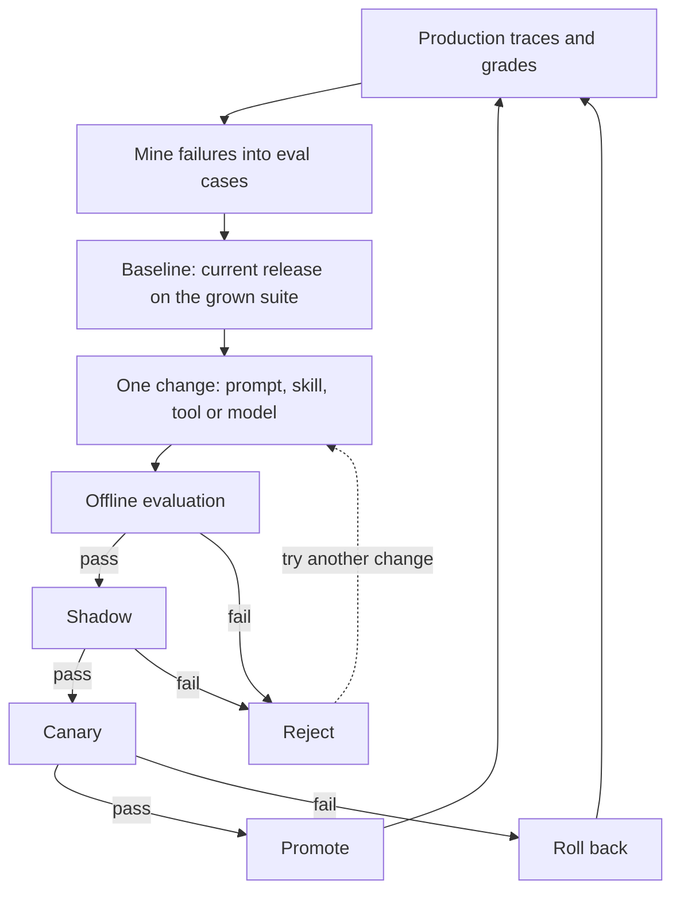

# Chapter 30: Deploying Agents: From One Service to an Agent Platform

Give another team your agent's URL and watch what happens in the first week. A script retries every failed call in a tight loop. Two browser tabs post to the same conversation at once. Someone guesses a session id, and the model provider has a bad five minutes on a Tuesday afternoon. In your terminal there was one user, and you were careful. A service has to survive callers who aren't.

Chapter 29 measured what your agent costs and how much load it takes. This chapter turns those numbers into a service that survives its first week, then follows the agent from one team to many. Taking an agent into one customer's environment is Chapter 31's subject.

**What you'll build:** a secured, streaming agent API; a token-protected remote MCP server; a deployable production image; start-and-poll report tools; a gateway that authorizes and audits every tool call; and a map of the platform your agents fit into.

**You are here:** User / API, and every layer at once in the agent architecture reference model (section 1.7).

**Prerequisites:** Chapter 19 (durable jobs), Chapter 26 (agent identity), Chapter 27 (evaluation), Chapter 28 (observability). This chapter puts the whole book together, so the more of it you've done, the more you'll get from it.

## Learning objectives

By the end of this chapter you can:

- Put an agent behind an authenticated, rate-limited, budgeted API, serve MCP remotely with a token, and deploy both as secure containers.
- Serve long-running work as start-and-poll tools that survive restarts.
- Put a gateway in front of several servers, choose servers from registries and plan company authorization.
- Name an agent platform's shared services and govern many agents.
- Release, version and retire an agent safely, and run the improvement loop that turns production failures into gated fixes.

**In the real world.** Users reach agents through an app or another service, which means an HTTP API, and GitHub and many other vendors now run remote MCP servers over HTTPS. So the questions become who is calling, how often, whose conversation it is and what a request may cost.

## 30.1 The architecture

Callers reach one container over HTTPS. The agent API checks the key, applies the caller's rate limit and loads the session, then hands the request to the agent loop with its budgets.

@@image d-fc1063615327.png

Figure: The deployed agent service
Alt: An app or user calls the agent service container over HTTPS with an API key; the platform's secret manager supplies keys at run time. Inside, the agent API handles authentication, rate limits and sessions, and the agent loop runs with budgets. The loop calls the model provider, a remote MCP server over HTTPS and the session database, and sends logs and traces to a collector.

On your laptop the session database is a SQLite file and the "collector" is your terminal.

## 30.2 The agent API

@@code ch30_service.py::api_key,rate_limit,session_lock,run,chat,chat_stream~

Run it with `./course.sh serve-api` and open `http://localhost:8080/docs`. Notice first that the service **refuses to start** without `AGENT_API_KEYS` (the `lifespan` check): a built-in default key is a password anyone can read in a book. (`./course.sh setup` put a random one in your `.env`.)

Every request needs `Authorization: Bearer <key>`. Keys are compared with `hmac.compare_digest`, which takes the same time wherever the strings differ, so nobody can guess a key by timing responses. After that, only a **key id** (a SHA-256 fingerprint of the key) reaches the session table and the logs.

Each key gets its own **token bucket** of `AGENT_RATE_PER_MINUTE` requests that refill continuously. Over the limit, the API returns **429** with a `Retry-After` header.

Sessions are where most homemade agent APIs go wrong. A guessable session id can be the only thing standing between one customer and another's conversation. Here, each conversation is stored with the key id that created it, so another caller who guesses the id gets a **404**. A session handles **one request at a time**: a second concurrent request gets **409**, because both would load the same history and one turn would be silently lost. History is bounded (`AGENT_MAX_HISTORY`) and cut only before a plain user message, as in Chapter 16.

The rest defends against cost and leaks. Chapter 4's `should_stop` hook enforces a step cap (`AGENT_MAX_STEPS`) and a token budget (`AGENT_MAX_TOKENS`), a failed model call gives the caller a generic **502**, and each request logs one JSON line with Chapter 28's trace fields, never the message text or the key.

## 30.3 Streaming progress

An agent can take many seconds to answer. `/v1/chat/stream` responds at once with **Server-Sent Events** (SSE), a standard way to push messages over one HTTP response: a `tool` event per tool call, then an `answer` event.

In production, a **keep-alive** comment every 15 seconds stops proxies from closing a quiet connection. And when the client **disconnects**, a `cancelled` flag tells `should_stop` to end the run, so you don't pay for an answer nobody reads:

@@code ch30_client.py::chat_stream,remote_tools

:::tip Two containers talking to each other
The service runs in a container named `agentic-ai-api` (and the MCP server in `agentic-ai-mcp`). `./course.sh python ch30_client.py` runs the client in a *second* container, where `localhost` means that container itself, so the client looks for those names first. Your browser uses `http://localhost:8080` as usual.
:::

Showing progress is the biggest single improvement to how fast an agent *feels*.

## 30.4 A remote MCP server

@@code ch30_remote_mcp.py::StaticTokenVerifier,require,build_server

A remote MCP server is reached by many MCP clients, so it needs real authorization. MCP uses **OAuth 2.1**, the standard protocol for granting apps limited access with tokens. Your server is a **resource server**: it never issues tokens or signs anyone in; it only checks tokens issued by an **authorization server**, your identity provider (Okta, Entra ID and so on).

It helps to keep apart what the protocol requires and what the SDK does for you. The protocol says a request without a valid token gets **401** with a `WWW-Authenticate` header pointing to the server's **protected-resource metadata** (RFC 9728), which tells MCP clients like Claude which authorization server to send the user to and which scopes exist. The SDK serves that metadata and sends the 401. Deciding what a token is worth stays your code's job.

That's `verify_token`: it decides whether a token is valid and what it may do. Here `MCP_TOKEN` may read and write and `MCP_READONLY_TOKEN` may only read, both looked up in your `.env`, which is a teaching shortcut. In production it would verify a signed JWT (JSON Web Token) from your identity provider, or ask the provider's introspection endpoint. These settings close real attacks:

- `validate_token_resource=True` rejects tokens issued **for a different server**, so a token meant for another MCP server can't be replayed here.
- **Scopes per tool**: `add_task` calls `require("todo:write")`, so the read-only token can list tasks but not add them.
- **Host checking** (`transport_security`) refuses requests with an unlisted `Host` header (421), which blocks DNS rebinding: a web page tricking your browser into calling a server on your machine.

Run it with `./course.sh serve-mcp` and connect with `./course.sh python ch30_client.py mcp`. Clients send the token with `create_mcp_http_client(headers=...)`, as `remote_tools` does.

:::warn Never pass the user's token through
If your MCP server calls another API on the user's behalf, don't forward the token it received: it was issued for *your* server, and the MCP specification forbids passing it on. Get a separate token for the downstream API (for example with OAuth token exchange). Always use HTTPS outside your own machine.
:::

## 30.5 Configuration and containers

Everything that differs between your laptop and production comes from environment variables: keys, limits, database paths and the model name. Nothing sensitive is in the image, and none of the limits is a guess; each comes from a number Chapter 29 measured:

Table: Where each deployment setting comes from {#t:settings-from-measurements}
| Setting | Set it from | Measured in |
| --- | --- | --- |
| Tasks in flight per instance (the gateway's concurrency cap) | The knee of the concurrency sweep | Section 29.5 |
| Maximum instance count | Forecast peak arrival rate divided by goodput at the knee, plus headroom | Sections 29.5 and 29.7 |
| Request timeout | p99 latency at the forecast arrival rate, plus a margin; longer work becomes a job (section 30.8) | Section 29.6 |
| `AGENT_MAX_STEPS`, `AGENT_MAX_TOKENS` | Steps and tokens per task on the evaluation suite, with headroom | Sections 29.2 and 29.4 |
| `AGENT_RATE_PER_MINUTE` and daily budgets | Cost per successful task and the business case's volume | Sections 29.4 and 29.9 |
| SLO targets: p95 latency, cost per success | The same numbers at the knee | Section 29.5, then section 28.10 |

So the sweep isn't a one-off. Rerun it after every model, prompt or tool change, and update these settings with it.

## 30.6 Deploying to the cloud {api}

Deploying proves your service works for someone else. Every managed container platform follows the same five steps.

:::tip On the free local model
Steps 1 and 2 work with `qwen3.5:9b`: pass `ANTHROPIC_BASE_URL=http://local-adapter:8787`, `ANTHROPIC_API_KEY=sk-local` and `MODEL=qwen3.5:9b` to the container and add `--network building-agentic-ai_default` to `docker run`. A cloud host can't reach your computer, so deploy with a Claude key.
:::

**1. Build a production image.** This Dockerfile copies only the four files your service needs, installs exact versions, runs as an unprivileged user and declares a health check:

@@code ch30_service.Dockerfile

@@code ch30_requirements.txt

Build it from your workspace folder, on your own computer: `docker build -f ch30_service.Dockerfile -t agent-api:1 .`. There's no key in it: secrets arrive when the container *runs*, so the same image can go to testing and production, and anyone who copies it gets nothing.

**2. Run it locally as the cloud will**, with secrets from the environment:

```
docker run -d --rm --name agent-api -p 127.0.0.1:8080:8080 \
  -e ANTHROPIC_API_KEY -e AGENT_API_KEYS agent-api:1
```

**3. Test it from the outside.** A **smoke test** is a short set of checks you run after every deployment: does it answer, does it refuse strangers, does a real question work? This one exits with an error if anything fails, so CI can stop a bad release:

@@code ch30_smoke_test.py::smoke

**4. Deploy to a managed host.** Google Cloud Run, AWS App Runner, Azure Container Apps, Fly.io and Render all run your image behind HTTPS and restart it when the health check fails. Their commands differ, but the steps are the same:

Table: Steps to deploy on a managed host
| Step | Why |
| --- | --- |
| Push the image to the platform's registry | The platform runs exactly the image you tested |
| Store `ANTHROPIC_API_KEY` and `AGENT_API_KEYS` in the platform's secret manager | Secrets never sit in the image, the code or a shell history |
| Set a **maximum instance count** and a request timeout | A spike or a looping agent can't run up an unlimited bill |
| Turn on log collection and a budget alert | The platform keeps and searches what goes to stdout |

Exercise 30.7 walks through Cloud Run. If you'd rather not host the agent loop at all, Claude Managed Agents (section 24.8) runs it for you.

**5. Smoke-test the real URL**, then read the first few log lines. Only then send users.

:::warn SQLite lives inside one container
`sessions.db` is a file inside the container. Cloud platforms start extra copies and replace containers freely, and each copy's file disappears with it. For a demo, limit the service to **one instance** and accept that sessions reset. For real users, move sessions and the in-memory rate-limit counters to a store every instance shares, such as PostgreSQL or Redis.
:::

## 30.7 Launch checklist

Check every item before real users arrive; each points to where you built it.

**Security and trust**

- [ ] Every endpoint but health checks needs a key or sign-in, and the service refuses to start without its keys (section 30.2).
- [ ] Sessions are private to their owner; keys are stored and logged only as fingerprints.
- [ ] The agent has its own identity and short-lived, scoped tokens; tools check ownership and limits (Chapter 26).
- [ ] Every box of section 25.2's security boundary has its control in code, not in the model's judgment.
- [ ] Every write tool needs approval or a reviewed policy; risky actions use step-up tokens (Chapters 9 and 26).
- [ ] Outbound requests go only to allowed sites, canaries and a leak scan guard tools, and output is sanitized (Chapter 25).
- [ ] Generated code runs in an isolated sandbox with no secrets (Chapter 10).
- [ ] Injection red-team tests pass with a model that obeys the attacker (exercise 25.6).
- [ ] Remote MCP servers verify token audience and scopes, over HTTPS (section 30.4).

**Quality**

- [ ] The evaluation suite grades outcome, process and cost, and gates every change in CI (Chapter 27).
- [ ] Continuous evaluation samples production runs and watches for drift (section 27.8).
- [ ] There's a clear path to a human when the agent can't help.

**Reliability**

- [ ] Timeouts, bounded retries and a clean error when the model API fails (Chapter 19).
- [ ] Long-running work is checkpointed and resumable, with idempotent side effects (Chapter 19).
- [ ] Every tool that changes something has a written tool contract for mutations (section 7.3).
- [ ] A health endpoint, a maximum instance count, a request timeout and a passing smoke test against the real URL (section 30.6).

**Cost, performance and operations**

- [ ] Step caps, per-request and per-user daily budgets are enforced in code, and alerts fire on unusual spend (Chapter 29).
- [ ] Prompt caching is on, simple steps use a smaller model where evals allow (Chapter 20), and offline work goes to the Message Batches API.
- [ ] Load-tested open-loop at expected peak; p95 latency, error rate and cost per successful task are known (Chapter 29).
- [ ] Every request is traced without secrets or personal data, and SLO alerts, dashboards and a runbook cover success, p95 latency, cost per success and tool errors (Chapter 28).
- [ ] Model name and prompt versions are pinned and logged with each trace.
- [ ] A kill switch disables the agent, a single tool or an agent identity at once (section 26.7).

**Where the course kit stops.** Ticking every box above with the kit's code gets you a production pattern, not a production-hardened system. The listings use demo keys, file or in-memory storage and a single process, and `code_maturity.json` in the course kit labels each one; none is hardened. Before real customers depend on it, work through "Appendix M: Production Deployment Reference", which covers what this checklist leaves to you: multi-tenant isolation, secret rotation, data retention, dependency and container scanning, backups and recovery, incident ownership and rollback criteria.

## 30.8 Long-running tools: start, then check

That's one service, built, deployed and checked, and for many teams that's enough. But the first agent in a company is rarely the last. Once a few teams ship agents, each wiring up its own MCP servers, the hard problems stop being about one container: tools that run for minutes, dozens of servers with no common front door, servers nobody has vetted, and sign-in that must work across the company. The next four sections take those in turn, and section 30.12 steps back to the platform they add up to.

Slow tools come first. Proxies close connections that stay silent too long, and a model waiting on a five-minute call holds everything up. Work that takes minutes (a report, an export, a deployment) needs a different pattern: **start the work, return a handle at once, let the caller check on it**.

@@code ch30_jobs_server.py::start_report,job_status~

`start_report` returns at once with a job id and a polling interval, while the work runs on Chapter 19's durable runner. `job_status` reports progress, then the result. A `request_id` makes starting safe to retry: an agent that times out and tries again gets the same job, not a second report. And when the server starts (`python ch30_jobs_server.py stdio`), `resume_unfinished` picks up jobs a previous process left behind without repeating finished steps. Run `./course.sh python ch30_jobs_server.py` to start a report for March 2026 and poll it to completion.

The status names come from MCP's **Tasks extension** (`io.modelcontextprotocol/tasks`), which makes this pattern part of the protocol:

Table: This chapter's job tools compared with the Tasks extension
|  | This chapter's tools | Tasks extension |
| --- | --- | --- |
| Starting | A `start_…` tool returns a job id | Any `tools/call` may return a task (`resultType: "task"`) with a `taskId` |
| Checking | A `job_status` tool | `tasks/get` |
| Asking for input | `input_required` with a note for a person | `input_required`, answered through `tasks/update` |
| Stopping | Your own tool | `tasks/cancel`, which is cooperative: the server may still finish |
| Statuses | `working`, `completed`, `input_required`, `cancelled` | The same, plus `failed` |

With the extension, the *MCP server* decides per call whether to answer directly or return a task, and the client handles whichever arrives, so a host can show progress for any slow tool without the model polling. That's the protocol; whether your client and SDK support it yet is a separate question, and support is still arriving. Until yours has it, the tools above work everywhere, and moving later changes only their wrapper, not the durable runner.

:::tip Who polls?
If the model polls, every check costs a model call. Let the host poll where you can, or give the model a tool that waits (exercise 30.10).
:::

## 30.9 Gateways: one front door

Once a company has many MCP servers, it puts a **gateway** in front: agents connect only to the gateway, and the gateway, acting as an MCP client, connects to the servers.

@@image d-ef89b841b81e.png

Figure: An MCP gateway in front of a company's servers
Alt: A planner agent and an analyst agent connect only to the gateway, which allow-lists tools, checks tokens, rate-limits, writes an audit trail and connects to the MCP servers: todo, shopdb and others.

It's Chapter 14's policy layer, moved out of one host and shared by every host in the company:

@@code ch30_gateway.py::POLICY,Gateway.call_tool,Gateway._check

It denies by default: when a server adds a `delete_everything` tool, no agent sees it until someone lists it in `POLICY`. Every call is authorized with Chapter 26's tokens, which name agent, user, audience and scopes, so the planner can add tasks but can't query sales. Per-agent rate limits stop one runaway loop from overloading a shared server, and one audit trail records every call, allowed or refused, with its arguments redacted as in section 28.3. The gateway also caches each server's tool list for as long as that server's `ttlMs` allows (`Gateway._refresh`), so it doesn't ask every server for its tools on every call. Run `./course.sh python ch30_gateway.py`:

```
agents see: ['search_tools', 'todo__add_task', 'todo__list_tasks', ...]
Added #1: Book flights
ERROR Not allowed: token lacks todo:write
...
ERROR Not allowed: no tool called 'todo__delete_everything'
```

### Progressive discovery

Fifty servers can offer a thousand tools, and listing them all makes the model worse at choosing (section 3.6). With `progressive=True`, the gateway lists only two:

@@code ch30_gateway.py::Gateway.search_tools

The model searches for what it needs ("task", "sales query"), gets back a few names with their schemas, and calls one through `use_tool`, which the gateway checks and audits like any direct call. It's the idea behind tool search in Claude's API, offered to any agent on any model.

:::warn A gateway is a high-value target
Every token, argument and result passes through it, so guard it like your identity provider. Keep it small, log where agents can't write, and call servers with the gateway's own narrowly scoped credentials, never an agent's token.
:::

## 30.10 Registries and the supply chain

The **MCP Registry** (`registry.modelcontextprotocol.io`) is the official catalog of public servers. It stores metadata, not code: a server's name, where to get its package or URL, and how to run it. Only the owner of an account or domain can publish under its name (`io.github.someone/weather`), so the registry proves who published a server, not that its code is safe; scanning is left to the package registries and the marketplaces built on top. Companies usually run a **private registry** listing only servers they've reviewed.

On top of Chapter 14's server review, pin versions (`server@1.4.2`, not "latest") and refuse any tool definition that changed after approval until someone reviews it, since a description is text the model reads. Run third-party servers with the fewest rights they need. `SECURITY_MODEL.md` in the course kit has more on the supply chain.

## 30.11 Authorization for companies {api}

The 2026-07-28 revision of MCP changed company sign-on. First, a client must check that an authorization response came from the authorization server it expected (the `iss` parameter, RFC 9207) before redeeming the code. That closes the *mix-up* attack, in which a malicious authorization server tricks a client into handing it a code meant for another. Second, clients identify themselves with a **Client ID Metadata Document**, a small JSON file at a URL they control, instead of registering with every server; Dynamic Client Registration, which left servers with thousands of unverified registrations, is deprecated. And the **Enterprise-Managed Authorization** extension lets the company's identity provider decide which servers an employee may use: the client, signed in with the employee's company account, asks the identity provider for a signed grant for one server, the provider checks company policy, and the server's authorization server exchanges the grant for an access token. Access is granted and revoked in one place.

All of this identifies the *user and the client application*. Which *agent* is acting, Chapter 26's question, is still open in MCP, so until it's answered, let section 30.9's gateway verify an agent token and record agent and user on every call. `SECURITY_MODEL.md` in the course kit covers the protocol details.

## 30.12 From one agent to an agent platform

Once support, finance and engineering each ship an agent, each team rebuilds model keys, agent sign-in, a tool gateway, an eval suite, traces and a budget alarm, and five teams end up with five ways to store a secret and five audit trails that don't join up. So most organizations end up with a **platform team** that offers **paved roads**, the supported way to do each job, and product teams write only their prompts, tools and evals. You've already built a small version of every piece:

Table: Platform components and where you built a small version
| Platform component | What it does | Where you built a small version |
| --- | --- | --- |
| Model gateway | Holds provider keys, routes by task, enforces budgets | Chapters 20 and 29 |
| Agent runtime and workflow | Runs the loop, keeps long jobs alive | Chapters 4, 19, 22 and 24 |
| MCP gateway | Authorizes, filters and logs every tool call | Section 30.9 |
| Identity and secrets | Scoped tokens for agents; no keys in code | Chapter 26, section 30.6 |
| Policy and approvals | Reviewed rules; risky actions go to a person | Chapters 9, 14 and 22 |
| Evaluation and observability | Suites, traces, SLOs and cost | Chapters 27, 28 and 29 |
| Memory and retrieval | Owned, scoped memories and hybrid search | Chapters 17 and 18 |
| Audit trail | Who did what, as which agent, for whom | Chapters 9, 26 and 28 |

@@image d-7c2fe2dcea53.png

Figure: The shared agent platform {#f:platform}
Alt: Four layers from top to bottom: agents built by product teams (support, finance, engineering); the platform's front doors and control (model gateway, MCP gateway, identity and policy); the platform's shared services (memory and retrieval, workflow and approvals, evaluation, traces and cost); and what the platform reaches (models, tools and data, people).

**Tenant isolation.** The platform in {{f:platform}} serves many tenants: customers, business units or teams. Sharing compute is fine, but memories (filtered by owner before ranking, section 17.7), sessions, per-user cached results (`private`, section 15.3) and tokens must never be shared. Give each tenant its own keys, rate limits and budgets, and put the tenant id on every trace so you can answer "which customers were affected?"

**Build, buy or run managed.** Ask of each component: *can we keep this running for three years without the core team becoming its on-call?* If not, buy or rent it. Either way, keep the interfaces your own (OpenTelemetry, MCP, your own eval cases) so you can swap a component later:

Table: Build or buy, for five platform components
| Component | Build it when | Buy or rent it when |
| --- | --- | --- |
| **Agent runtime and orchestration** | A few agents, and this book's loop is enough | Many teams need queues, isolation and support |
| **Memory and state** | The data is sensitive and the rules are yours | You need replication and expiry at high volume |
| **Retrieval index** | The collection is small or changes constantly | The collection is large |
| **Observability** | Rarely | Almost always, sending OpenTelemetry |
| **Evaluation** | The checks and cases, which only you can write | The runner, dashboards and judge tooling |

**What to standardize first.** Start with the parts that are risky and hard to change later:

1. **Identity and secrets**, because retrofitting identity after 20 agents ship is painful.
2. **Gateways**, one place for keys, budgets, allow-lists and logging.
3. **Tracing and cost attribution**: agent, user, tenant and team on every call.
4. **Evaluation gates** in CI for every agent change.
5. **Shared memory and retrieval**, once teams keep building the same index.

**Governance.** With dozens of agents live, someone must be able to say which agents exist, who owns each, what each can touch and who approved it. Keep an **agent inventory**, one record per agent (owner, model, tools and scopes, data, risk tier, version), in Chapter 26's identity registry. Hold **launch reviews by risk tier**: a read-only helper needs an eval suite and an owner, while an agent that moves customers' money also needs a threat model, red-team results, a scorecard and a security sign-off. Set retention for traces, memories and logs, and make deletion requests reach every store (section 17.6). Check with your legal team which laws apply (the EU AI Act treats hiring and credit as high-risk uses). Decide who may flip the kill switch, and end every incident with a postmortem and a new evaluation case. `ARCHITECTURE.md` in the course kit has more on the platform.

## 30.13 The agent lifecycle in production

Section 1.10 named the stages of the agent engineering lifecycle. You've now built a piece of each, and {{t:lifecycle-now}} says where:

Table: The lifecycle stages you've now built {#t:lifecycle-now}
| Stage | What you have now |
| --- | --- |
| Decide and design | Sections 1.3 and 1.9's questions, decision records (Appendix K), the reference architecture (section 30.15) |
| Build | Everything in Chapters 2–24, from the loop to teams and controls |
| Secure | A threat model, regression scenarios and a risk tier (Chapter 25), identities and tokens (Chapter 26) |
| Evaluate | Trials and intervals, trajectory checks and a scorecard (the measurement interlude, Chapter 27) |
| Optimize | Context engineering (Chapter 16), model routing (Chapter 20), cost, capacity and economics (Chapter 29) |
| Deploy | A CI gate (section 27.7), a launch checklist (section 30.7) and a container you can deploy (section 30.6) |
| Operate | Traces, failure classes, SLOs and alerts (Chapter 28), budgets and capacity (Chapter 29) |
| Improve | Graded production samples (section 27.8) and the improvement loop (section 30.14) |

What follows matters only once an agent has real users, and skipping any of it lets a good agent cause a bad incident.

**Deploy gradually.** First **shadow** a new prompt, tool or model: run it on a copy of real traffic without showing its answers or taking its actions, and grade both versions. Then **canary** it: send 1%, then 10% of traffic, and compare its SLOs with the old version's. Keep the old version running so you can **roll back** with configuration, automatically if the canary burns its error budget (section 28.10). A shadow can't issue real refunds, so for an agent that acts, record what it *would* have done.

**Version the whole agent.** Behavior comes from the model id, system prompt, tool definitions, MCP server versions, skills, policies and the eval suite that approved them. Version that bundle as one release, put it on every trace, and pin the model to a dated id rather than an alias that moves.

**Plan for the model to change.** Providers retire models, and a new one can be better on average and worse for *your* agent. Run your suite on it, recalibrate any model judge (section 27.2), compare cost per success, then shadow and canary it.

**Retire it cleanly**, because a half-retired agent still holds credentials. Point its users elsewhere, flip its kill switch, remove its gateway routes and inventory entry, revoke its identity and every derived token (section 26.7), cancel its scheduled jobs and leases (Chapter 19), delete its secrets and apply the retention policy to its data, keeping the audit log as long as the policy says. `AGENT_LIFECYCLE.md` in the course kit has the full checklist.

## 30.14 The agent improvement loop

Join traces and failure classes (Chapter 28), suites and a regression gate (Chapter 27), measured latency and cost (Chapter 29) and gradual release, and you get the **agent improvement loop**: the routine that turns a production failure into a release proven better before every user gets it. Most teams call this practice AgentOps.



Figure: The agent improvement loop {#f:improvement-loop}
Alt: Production traces and grades feed failure mining, which produces labeled eval cases. The current release is measured on the grown suite as the baseline, then one change makes a candidate, which passes offline evaluation, shadow and canary in turn. Failing offline or in shadow rejects it and leads back to trying another change; failing the canary rolls it back. Promote and roll back both lead back to production traces.

Code decides every gate, against thresholds written down in advance:

Table: The stages of the improvement loop {#t:improvement-stages}
| Stage | Who decides |
| --- | --- |
| Mine failures | `classify_detailed` names each failed run's class (section 28.8) |
| Build cases | A person labels; code removes duplicates |
| Baseline | Nobody: the current release on the grown suite is the yardstick |
| Change | The engineer, producing a new bundle version |
| Offline evaluation | `gate` must not block, no old case may break, 90% of mined-case runs pass |
| Shadow | `gate` must not block; worse on at most 2% of mirrored requests |
| Canary | A missed SLO or burn over 1 rolls back; under 30 runs holds |
| Promote or roll back | Code, applying thresholds agreed in review, writing a decision record |

**Mining failures.** The loop starts from the production runs section 27.8 already graded:

@@code ch30_improvement_loop.py::mine_failures,to_cases

There's no new classifier: Chapter 28's `classify_detailed` names the classes, and a failed run that matches none is labeled `unclassified`, a sign the taxonomy needs a new class. The expected answer comes from a reviewer, never from the trace, because a guessed answer teaches the gate to block the fix. And deduplicate: in the demo, 44 failed runs are three distinct problems, and without `normalize` the most frequent one would swamp the suite. `normalize` only merges questions that differ in case, spacing and punctuation; paraphrases need embedding similarity (section 18.3) and a person to confirm the group.

**Offline evaluation.** The baseline is the current release, run on the same grown suite as the candidate, so both face the same questions:

@@code ch30_improvement_loop.py::offline_eval

`gate` is section 27.7's statistical test over three trials per case. The other rules are absolute: an old case that now fails is a regression however good the average looks, and a change meant to fix the mined cases has to fix them.

**Shadow, then canary.** Offline cases are the questions you thought of. The next two gates use real ones:

@@code ch30_improvement_loop.py::shadow,measure_arm~,canary

In shadow, users get the current version's answer (`shown`) while the candidate's is graded and dropped. The demo grades with the reviewer's label; on live traffic nobody has written an expected answer yet, so you'd grade with section 27.8's checks and calibrated judge. The canary sends 10% of requests to the candidate by a stable hash; in production, hash the user so nobody bounces between versions. `measure_slos` (section 28.10) measures each side, and the burn rate says how fast it spends its error budget: 1 means failing exactly as often as the objective allows, 3.3 means 3.3 times as often. Under 30 runs the canary holds rather than passes: with fewer, a 95% success target allows less than two failures, so a handful of runs can't show an SLO is met.

**One turn of the loop.** `improvement_turn` runs the stages in order, stopping at the first gate that fails:

@@code ch30_improvement_loop.py::GATES,improvement_turn

Run `./course.sh python ch30_improvement_loop.py`. Release 1.4 is in production and fails three kinds of question: it loops on a failing query, makes up a revenue figure and misreads which region sold most. Release 1.5 fixes all three with a new prompt and tool description. Release 1.6 fixes them too, with far more thinking per step:

```
sql-analyst 1.5 (replacing sql-analyst 1.4)
  mined     44 failed runs -> 3 new cases (41 duplicates dropped)
...
  offline   PASS  10 cases x 3 trials: baseline 70%, candidate 100%
            z=-3.25, old cases broken 0, mined cases passed 100%
  shadow    PASS  100 mirrored requests: candidate better on 21, worse on 0
...
  canary    PASS  44 runs: success 100%, p95 2,760 ms, $0.014/task, burn 0.0
            current version: success 84%, burn 3.3
  decision  PROMOTE

sql-analyst 1.6 (replacing sql-analyst 1.4)
  ...
  canary    STOP  44 runs: success 100%, p95 9,260 ms, $0.014/task, burn 0.0
            current version: success 84%, burn 3.3
            because: missed p95 latency (ms)
  decision  ROLLBACK
```

Release 1.5 is promoted. Release 1.6 gives the same right answers, so it passes offline and in shadow, but the canary rolls it back: its answers take over nine seconds against an 8-second p95 objective. (The current version's burn rate of 3.3 is why the loop ran at all.) The demo writes each decision, with its reasons and numbers, to `release_decisions.json`; keep it with the bundle version so an incident leads back to the evidence.

The mined cases join the suite whatever the decision, so any later release that makes up the revenue figure again is rejected offline, before a single user sees it. People still make the judgment calls, writing labels and setting thresholds; code applies them the same way every time. The demo's agents are fakes that answer the same way every time, so the loop shows the gates, not real variance. In production you'd also mirror traffic at the gateway, raise the canary in steps (1%, 10%, 50%) over hours with burn-rate alerts on two windows (section 28.11), and compare cost per successful task, not only cost per task. Exercise 30.12 moves the latency check into shadow, so a slow release never reaches a user at all.

## 30.15 The end-to-end reference architecture

Here is section 1.7's agent architecture reference model again, now that you've built every layer.

@@image d-bf14742724b1.png

Figure: The agent architecture reference model, with every layer now built
Alt: The same layered diagram as {{f:reference-model}}: user or API; the agent runtime with planning, memory, context, tools and policies; the model; MCP, APIs and A2A; the environment; with evaluation and observability across all layers.

Follow a request down the picture: it arrives through the API, the runtime prepares each step, the model chooses one, and tool calls travel over MCP, APIs or agent-to-agent (A2A) protocols to the environment, with evaluation and observability around all of it. {{t:layers-built}} shows where the book builds each layer.

Table: Where the book builds each layer {#t:layers-built}
| Layer | Where the book builds it |
| --- | --- |
| User / API | Chapter 30 |
| Agent runtime | Chapters 4, 19 and 24; its speed and cost in Chapter 29 |
| Planning | Chapters 11 and 20 |
| Memory | Chapters 5, 17 and 18 |
| Context | Chapters 6 and 16 |
| Tools | Chapters 2, 3, 7, 8 and 9 |
| Policies | Chapters 9, 14, 22, 25 and 26 |
| Model | Chapters 1, 4 and 20; its speed and cost in Chapter 29 |
| MCP, APIs, A2A | Chapters 7, 12 to 15, 21 and 30 |
| Environment | Chapters 6, 10 and 23 |
| Evaluation and observability | Chapters 27 and 28, with first versions in Chapters 3, 4 and 8 |

Walk these layers top to bottom when you design a new agent, and again when one fails in production.

:::note The support agent so far
The support agent ships as a secure, smoke-tested service on a shared platform next to other teams' agents. Capstone 1 asks you to build its core yourself, and its extension challenges serve it through the Chapter 30 API.
:::

## Common mistakes

- No authentication "because it's internal", or session ids as the only protection.
- One global rate limit, so one looping client starves everyone.
- Returning stack traces, or logging prompts and keys.
- No smoke test against the public URL, or no kill switch an on-call engineer can flip in seconds.
- Tools that block for minutes, or jobs without an idempotency key.
- Passing an agent's token through a gateway, or treating a registry listing as a security review.
- Fixing a production failure without adding its case, so the next release brings it back.

## Before you move on

- **You should understand:** why a session stores its owner's key id and takes one request at a time, and why a gateway never forwards an agent's token.
- **You should be able to build:** a deployed agent API that refuses a wrong key (401), another caller's session (404) and a second concurrent request (409), with a smoke test against its public URL.
- **Prove it:** exercise 30.7, then exercise 30.12.
- **Break it on purpose:** run two copies of the service, each with its own `sessions.db`, and alternate one session's turns between them: the follow-up loses its context and each key's rate limit doubles (section 30.6).
- **Defend this decision:** why a canary that misses its p95 objective rolls back automatically instead of waiting for a person.

## Key takeaways

**Architect's takeaway:** Put every agent behind one front door that authenticates, limits and audits, keep tenants apart, and let code gate every release.

- An agent service needs auth, per-caller rate limits, private sessions, budgets, clean errors and streaming, shipped as a small non-root image with secrets at run time and a smoke test.
- Long-running tools return a job handle at once, run durably and are safe to retry.
- A gateway allow-lists, authorizes, rate-limits and audits; registries verify publishers, not code.
- Standardize identity and secrets first; never share memory, sessions or tokens between tenants.
- Release gradually, version the whole agent and retire agents cleanly.
- Every production failure becomes a permanent eval case.

## Learn more

| Resource | What you'll find |
| --- | --- |
| **FastAPI tutorial**<br>[fastapi.tiangolo.com/tutorial](https://fastapi.tiangolo.com/tutorial/) | Build a web API step by step; the base of ch30_service.py |
| **MDN: Using server-sent events**<br>[developer.mozilla.org/en-US/docs/Web/API/Server-sent_events/Using_server-sent_events](https://developer.mozilla.org/en-US/docs/Web/API/Server-sent_events/Using_server-sent_events) | How streaming responses reach the browser |
| **MCP: Tasks extension**<br>[modelcontextprotocol.io/extensions/tasks](https://modelcontextprotocol.io/extensions/tasks) | How tasks are created, polled, updated and cancelled (section 30.8) |

## Exercises

:::ex Concept | 30.1 | Pick the status code
Which HTTP status should the API return, and why: (a) no key; (b) valid key, over the rate limit; (c) message longer than 4,000 characters; (d) someone else's session id; (e) the model API is down; (f) a second request for a session that is still answering the first?
**Done when:** Each has a code (401, 429, 422, 404, 502, 409) and a reason.
:::

:::ex Simple | 30.2 | Call your agent API
Start `./course.sh serve-api`, then in another terminal run `./course.sh python ch30_client.py`. Try the interactive docs at `http://localhost:8080/docs` too.
**Done when:** A follow-up question in the same session is answered using the first answer's context.
:::

:::ex Simple | 30.3 | Hit the limits
Set `AGENT_RATE_PER_MINUTE=2` and send four requests quickly; then send a request with a wrong key.
**Done when:** You've seen a 429 with a `Retry-After` header and a 401.
:::

:::ex Medium | 30.4 | Stream the words
Add a `/v1/chat/stream_text` endpoint that streams the **final answer text** as it's generated, using `client.messages.stream(...)` and its `text_stream`, after any tool steps.
**Hint:** Run the tool steps with `run_agent`, then make one more streaming call for the answer, or stream every call and forward `text` events.
**Done when:** A client sees the answer appear in pieces, not all at once.
:::

:::ex Medium | 30.5 | Remote MCP with your agent
Point the Chapter 13 hub at the remote to-do server over HTTP with its token, instead of starting it over stdio.
**Hint:** Add a `"url"` option to the hub's server config and use `streamable_http_client` with `create_mcp_http_client(headers=...)`.
**Done when:** The agent adds and lists tasks through the remote server, a wrong token fails with a clear error, and with `MCP_READONLY_TOKEN` it can list tasks but adding one is refused.
:::

:::ex Complex | 30.6 | Production drill
Load-test the agent API with 20 concurrent users for 2 minutes (adapt `ch29_loadtest.py` to call it over HTTP), with a rate limit of 30 per minute per key and five keys. Record p50/p95 latency, 429 and 502 counts, and cost per request from the logs. Then make one change that improves p95 and measure again.
**Done when:** You have a before-and-after table and a short write-up of the change.
:::

:::ex Complex | 30.7 | Ship it
Build the image with `ch30_service.Dockerfile` and pass `ch30_smoke_test.py --chat` locally. Deploy to a managed host with secrets in its secret manager, one instance at most and a request timeout; smoke-test the HTTPS URL, then delete it.
**Done when:** The smoke test passes locally and on the HTTPS URL; the deployment is deleted.
---kit---
Build the production image with `ch30_service.Dockerfile`, run it locally with secrets passed at run time and pass `ch30_smoke_test.py` against it (including `--chat`). Deploy it to a managed container host (the solution uses Google Cloud Run) with secrets in the platform's secret manager, one instance at most and a request timeout. Smoke-test the public HTTPS URL, then delete the deployment.
**Hint:** Run Docker commands on your own computer, from your workspace folder. To test a container from another container, share its network: `docker run --network container:agent-api ...`. Most platforms have a free tier; set a budget alert anyway.
**Done when:** The smoke test passes against your local container and against the HTTPS URL, you can say where each secret lives, and the cloud deployment is deleted.
:::

:::ex Concept | 30.8 | Who asked for this, at company scale?
For each piece in sections 30.8 to 30.11, name who benefits and what went wrong before it: (a) the Tasks extension; (b) a gateway in front of every server; (c) Client ID Metadata Documents; (d) Enterprise-Managed Authorization.
**Done when:** Each has a beneficiary (user, host, security team, server operator, employee) and a concrete problem it solves.
:::

:::ex Medium | 30.9 | Search what you may use
Change the gateway's `search_tools` so it returns only the tools the caller's token allows, and nothing for a caller without a valid token.
**Hint:** A tool function can accept a `Context` argument; `_token(ctx)` finds the caller's token.
**Done when:** A planner with `todo:read` finds only the two read tools, an analyst searching for "task" finds nothing, and a caller with no token finds nothing.
:::

:::ex Medium | 30.10 | Fewer polls, safe retries
Give `job_status` a `wait_s` parameter (at most 20 seconds) that holds the call until the job finishes or the time runs out. Then show that calling `start_report` twice with the same `request_id` returns the same job.
**Done when:** Waiting takes one status call where short polling took several, and both starts share one job id.
:::

:::ex Complex | 30.11 | An agent behind the gateway
Run the Chapter 13 agent with the gateway as its only server: the host starts `ch30_gateway.py stdio` for the planner agent and passes its token in the environment. Ask it to add a task and to count cancelled orders.
**Done when:** The agent finds tools through `search_tools`, the task is added, the order query is refused and reported honestly, and the audit trail shows both calls with the agent and the user.
:::

:::ex Medium | 30.12 | Catch it in shadow
Write a stricter shadow stage that also measures both versions with `serve` and `measure_arm`, rejecting a candidate that misses the latency or cost SLO or costs over 20% more per task. Run it for releases 1.5 and 1.6.
**Done when:** 1.6 is rejected at shadow for p95 latency, 1.5 promoted, a pricier model rejected for cost.
---kit---
In section 30.14's demo, release 1.6 passes shadow and only the canary catches its latency, after real users have waited. Write a stricter shadow stage that also runs both versions through `serve`, measures each with `measure_arm`, and rejects the candidate when it misses the latency or cost SLO or costs more than 20% above the current version per task. Run `improvement_turn` with your stage in place of `shadow` for releases 1.5 and 1.6.
**Hint:** Call the original `shadow` first and add to its `reasons`. `improvement_turn` looks `shadow` up by name in its module, so you can swap it in and put the original back afterwards.
**Done when:** Release 1.6 is rejected at shadow with a reason naming p95 latency and serves no user requests, release 1.5 is still promoted, and a candidate on a pricier model than the current one is rejected for cost.
:::

## Checkpoint: end of Part 9

- [ ] Run an evaluation suite with repeated trials in CI, and calibrate a model judge against human labels.
- [ ] Trace every model call and tool call, and find the slow or failing step from the traces.
- [ ] Load-test an agent with correct latency measurement and report cost per request.
- [ ] Deploy an agent behind an authenticated, rate-limited, budgeted API to a cloud host, pass a smoke test, and serve MCP remotely.
- [ ] Serve long-running work as durable, retry-safe jobs.
- [ ] Put a gateway in front of several servers that authorizes, rate-limits and audits every call.

That list is an ordinary week's work for a practicing agent engineer. If a box is still unchecked, go back to its chapter now; Part 10 assumes all six.

:::note Ready for Part 10?
You're ready if you can do three things without the book open: read a pilot's success rate as a Wilson interval and say whether 37 of 40 clears 85% (section 27.6 and the measurement interlude); walk section 30.7's launch checklist and point to the code behind each box; and say which number from Chapter 29 sets each deployment setting in section 30.5. On the forward-deployed path, sections 30.1–30.7 and 30.13 are the minimum; Chapter 31 leans on them directly.
:::

## Up next

That completes Part 9: you can build, secure, evaluate, deploy and improve an agent you own. Many agents, though, live in a customer's business, on their data and under their rules, and the customer decides what done means. Part 10 is about shipping those.
