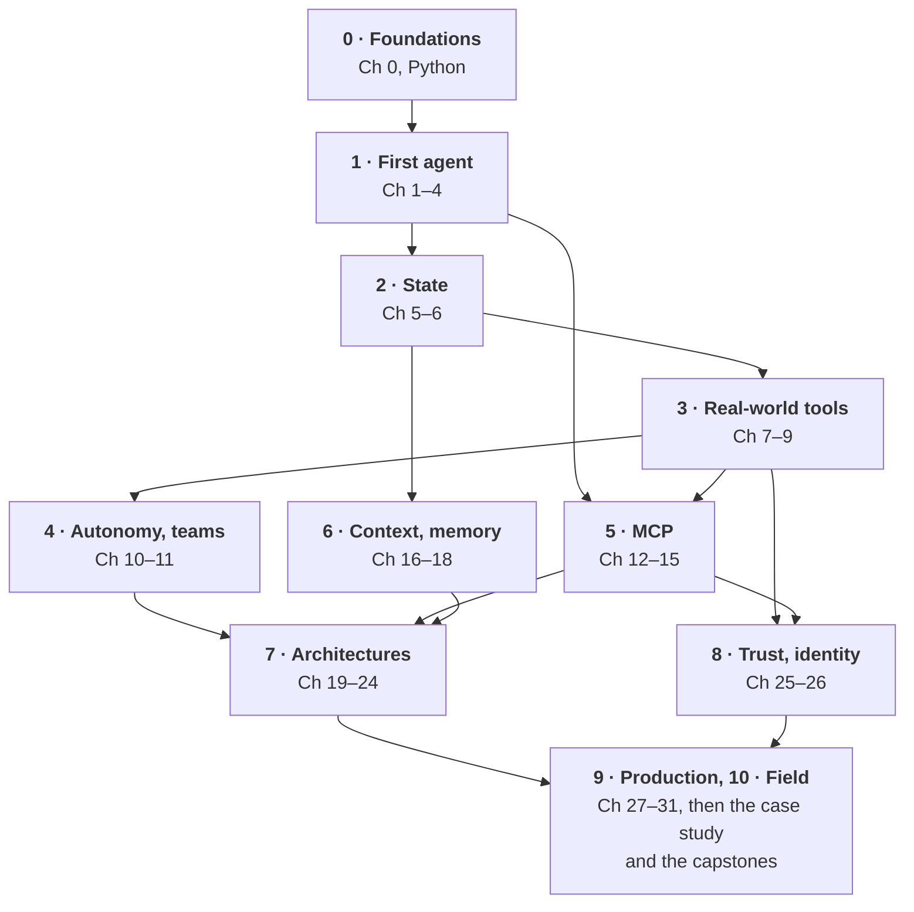

# Preface

Ask a chatbot how many days are left until July 4 and it will often get the answer wrong, because it doesn't know today's date. Give the same model a calendar tool and a few lines of code that run it, and it gets the answer right. That small gap, between a model that talks and a program that acts, is what this book is about. The systems that matter in 2026 look things up, run code, query databases, fix failing tests and ask a person before doing anything risky. They're called *agents*, and building them well is one of the most useful skills in software.

It's also confusing to learn. Some tutorials hide everything behind a framework: you get a demo in ten minutes and no idea why it failed in production. Others assume you already write Python and know web APIs. Neither prepares you for what matters once real users arrive: security, evaluation, cost and reliability.

I wrote this book to close that gap. You **build agents from first principles, then make them secure, measurable, cost-aware and production-ready**. That route fits in five words, *build, secure, evaluate, optimize, deploy*, and the building starts early. By Chapter 4 you've written the loop every agent runs on, even if Chapter 0 was the first code you ever ran. Then you package tools with MCP, the Model Context Protocol, and put small teams of agents to work under code's control, learning along the way when a team beats a single agent and when it only costs more. The rest of the book covers the other four words: securing, evaluating, optimizing and deploying what you've built.

I came to agents from performance engineering, after twenty years of making systems fast and dependable under load. The first time I load-tested an agent, the model was the least of my problems. The loop around it retried a slow tool, the bill climbed faster than the latency did, and nothing in my usual dashboards explained why. That experience shaped this book: an agent is software first, and it deserves the same engineering as any service you'd put in front of customers.

## What makes this book different

**You build everything by hand first.** Before you touch a framework, you write the agent loop yourself: call the model, run the tools it asks for, send back the results, repeat. Once you've written it, every framework becomes readable, and you can debug the ones you choose to use.

**Every chapter ends in working code.** You build more than 20 agents and tools, from a safe calculator to a code-fixing agent that runs tests, a SQL analyst that corrects its own queries, a research team and a deployed agent API. Seven capstone projects then ask you to design a complete system of your own, the last one for a customer.

**Safety and measurement are part of the craft.** Agents act on the world, so you treat risk the way production teams do: approval gates in code, sandboxes, defenses against prompt injection, and the "lethal trifecta" of private data, untrusted content and a way out. You also learn to measure. A change isn't an improvement until an evaluation suite says so, with enough trials to tell a real gain from luck.

**It follows open standards.** Part 5 is built around MCP, and the production chapters keep to it. You also meet Agent Skills and the A2A protocol for agents that talk to other agents.

**It gives you mental models as well as code.** Agent projects go wrong in the same few places, and a shared vocabulary helps you see those places before you're standing in them. Chapter 1 sets out the frameworks the book uses, and Appendix I collects them as reference cards you can keep beside you at a design review. One system, an enterprise support agent, grows chapter by chapter from a single model call into a production service, so you can watch the ideas add up.

**It keeps concepts apart from products.** The code uses the Claude API and a free local model, but every idea is taught as a concept first, and Appendix J maps each one to other providers and open-source stacks.

**Everything runs the same way on every computer.** A Docker-based course kit gives you the same Python, libraries, sample data and MCP servers on Windows, macOS and Linux. You install nothing but Docker.

## Who this book is for

Anyone who wants to build AI agents. If you've never programmed, Chapter 0 and the Python interlude teach the programming you need, and you can complete Parts 0 to 4 with this book alone. From Part 5 on, the chapters assume you've done the earlier exercises and can read a page of Python and a stack trace without help; that's what the first four parts give you. You don't need a background in machine learning, because you won't train a model here; you'll build reliable software around one. Architects, production engineers and forward-deployed engineers each get their own reading path in "How to Use This Book."

## How the book is organized

The book has eleven parts, from an optional beginner path (Part 0) to taking agents into a customer's business (Part 10), followed by a case study and seven capstone projects. Short interludes teach supporting skills right before the chapters that need them.

In the diagram below, an arrow means the later part uses what the earlier one builds, so you can see what to read first if you want to jump ahead. Each chapter's Prerequisites line gives the detail.

Figure: The book at a glance: how the parts build on each other
Alt: Part 0, Foundations, leads to Part 1, First agent. Part 1 leads to Part 2, State, and to Part 5, MCP. Part 2 leads to Part 3, Real-world tools, and to Part 6, Context and memory. Part 3 leads to Part 4, Autonomy and teams, to Part 5 and to Part 8, Trust and identity. Parts 4, 5 and 6 lead to Part 7, Architectures. Part 5 also leads to Part 8. Parts 7 and 8 lead to Part 9, Production, and Part 10, In the field, which are followed by the case study and the capstones.

Every exercise has a reference solution in the course kit. "How to Use This Book," which follows, tells you where to start and how each chapter is laid out.

## Conventions used in this book

- `Code font` marks code, file names, commands, functions and values you type.
- A heading labeled **Listing** introduces a file, or an excerpt of one, from the course kit. It's already in your workspace; you don't need to type it. Each listing says what kind of code it is, so you never mistake teaching code for production code:
    - *Learning demo*: one idea, shown as plainly as possible. Run it and change it; don't build on it.
    - *Prototype*: a working agent or tool you can extend. Single user, simple storage, no authentication.
    - *Production pattern*: the controls and records a production system uses, simplified (file storage, demo keys, one process). The chapter says what a production version adds.
    - Nothing in the kit is *production-hardened*; Chapter 30's launch checklist says what that takes.
- Commands start with `./course.sh`. On Windows, use `.\course.cmd` instead.
- **Tip** boxes give shortcuts and good practice. **Caution** boxes point out mistakes that cost money, lose data or open a security hole. **The support agent so far** boxes follow the running example.
- **You are here** names the layers of the reference model (section 1.7) a chapter builds.
- **API-dependent** under a section heading means the concept is durable but its names, parameters or prices change often.
- Exercises are labeled **Concept** (no code), **Simple**, **Medium** or **Complex**, and each has a **Done when** line so you know when you've finished.

## Using the code

All code, sample data, starter files, checkers and solutions are in the course kit, the book's companion repository at **github.com/sbittla/building-agentic-ai**. Setup takes about 15 minutes. The examples use Anthropic's Claude models through the Claude API, which needs an API key and a little credit. If you'd rather not pay, the kit can run a free open-source model, `qwen3.5:9b`, in Docker on your own computer; Appendix H shows how, and every exercise is labeled with the model it needs. Appendix E estimates the cost: about {{cost:learner}} in API usage for all the chapters on Claude Sonnet 5, about half on Claude Haiku 4.5, and nothing on the local model.

The kit pins every library version so the examples keep working as the field moves.

This edition is matched by a release of the repository tagged `book-v1.0.0`: `git checkout book-v1.0.0` gives you the code, data and solutions this book was written against, and the tag never moves. `VERSION_MATRIX.md` lists the version of every library, model and protocol it was tested with, and exactly what that testing covered; `CHANGELOG.md` lists what changes on `main` after release, and `ERRATA.md` any mistakes found in this edition.

## A note on currency

This book was written and tested in September and October 2026. Its core ideas (the agent loop, tool design, approval gates, evaluation, context management and the lethal trifecta) have held steady as models improved, and I expect them to keep holding. When model names and API details change, check `VERSION_MATRIX.md` and Appendix G first.

The first agent you'll build is a few dozen lines long, and it will answer that July 4 question correctly. Open the course kit, run the setup, and let's build it together.

*Srinivasa Rao Bittla* *October 2026*
